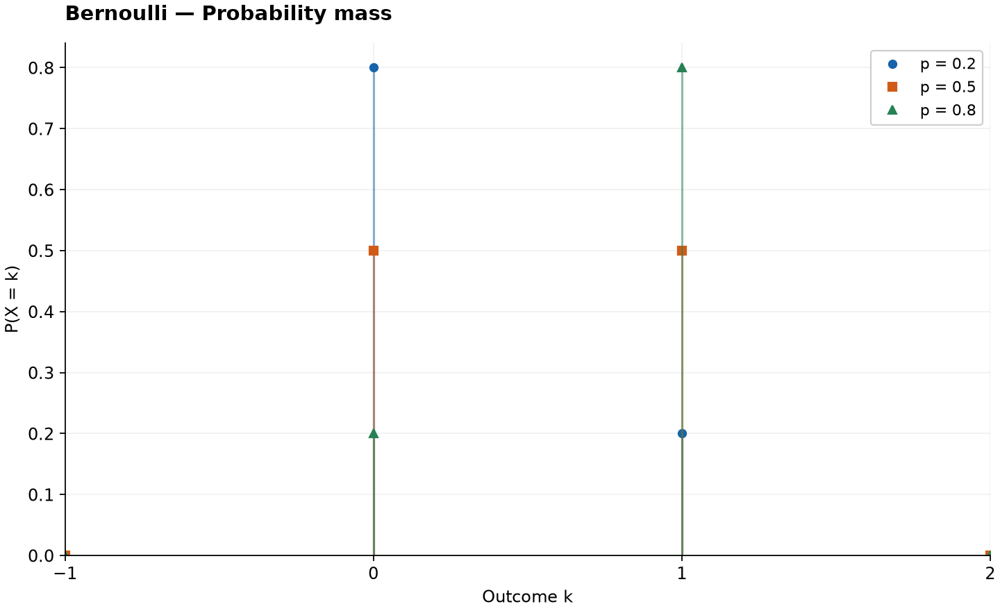
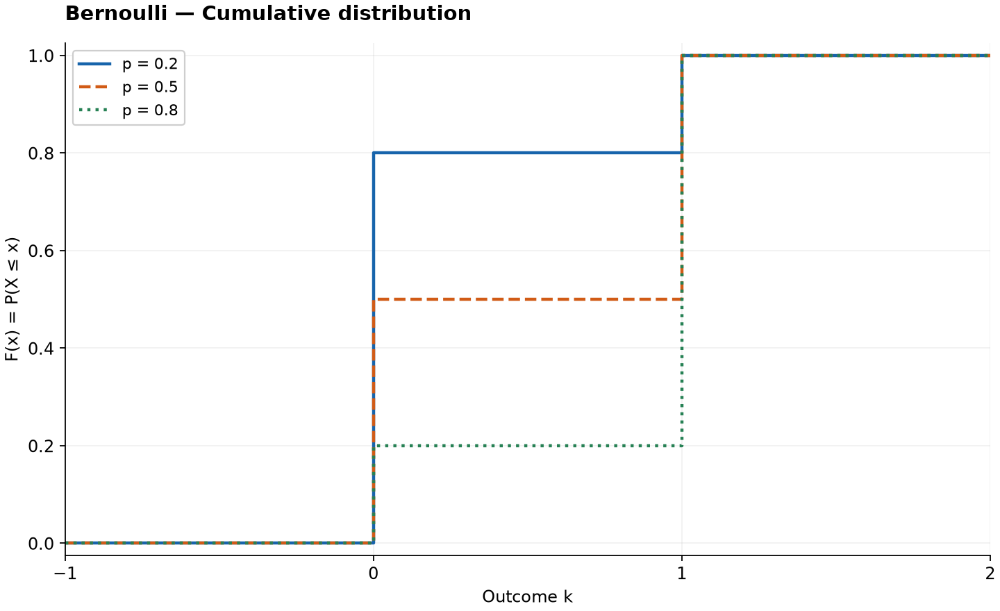

# Bernoulli Distribution

Original guide. Reference: [SciPy `bernoulli`](https://docs.scipy.org/doc/scipy/reference/generated/scipy.stats.bernoulli.html), checked 2026-10-25. [Collection notes](README.md#source-and-conversion-notes).

## Use and parameters

One binary outcome: a click, a successful request, or a defective component. Write $X=1$ for success and $X=0$ for failure. The parameter $p\in[0,1]$ is the success probability. At either endpoint the outcome is deterministic.

## Probability Mass Function

$$
P(X=k)=\begin{cases}1-p,&k=0,\\p,&k=1,\\0,&\text{otherwise}.\end{cases}
$$

## Cumulative Distribution Function

$$
F(x)=\begin{cases}0,&x<0,\\1-p,&0\le x<1,\\1,&x\ge1.\end{cases}
$$

For $0<q<1$, the quantile is zero when $q\le1-p$, and one otherwise.

## Common Statistics

| Statistic | Value |
| --- | --- |
| Mean | $p$ |
| Variance | $p(1-p)$ |
| Mode | 0 if $p<1/2$; 1 if $p>1/2$; both if $p=1/2$ |

## Estimation and software

For independent observations sharing $p$, the maximum likelihood estimate is the sample proportion $\hat p=\bar x$. Use `scipy.stats.bernoulli(p)`.

For example, $p=0.3$ assigns probability 0.7 to zero and 0.3 to one.

## Related distributions

Summing $n$ independent Bernoulli variables with the same $p$ gives a [binomial](binomial-distribution.md). Waiting for the first success gives a [geometric](geometric-distribution.md).
