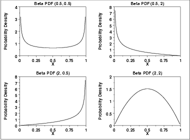
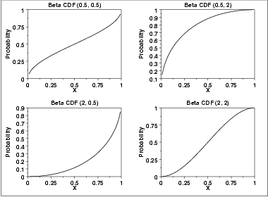
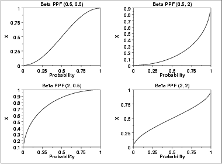

# Beta Distribution

Source: [NIST/SEMATECH e-Handbook of Statistical Methods — 1.3.6.6.17. Beta Distribution](https://www.itl.nist.gov/div898/handbook/eda/section3/eda366h.htm).

Retrieved: 2026-10-25. [Attribution and conversion notes](README.md#source-and-conversion-notes).

## Probability Density Function

The general formula for the [probability
density function](https://www.itl.nist.gov/div898/handbook/eda/section3/eda362.htm#PDF) of the beta distribution is

$$
f(x) = \frac{(x-a)^{p-1}(b-x)^{q-1}}{B(p,q) (b-a)^{p+q-1}} \hspace{.3in} a \le x \le b; p, q > 0
$$

where *p* and *q* are the [shape
parameters](https://www.itl.nist.gov/div898/handbook/eda/section3/eda363.htm), *a* and *b* are the lower and upper bounds,
respectively, of the distribution, and *B*(*p*,*q*) is
the beta function. The beta function has the formula

$$
B(\alpha,\beta) = \int_{0}^{1} {t^{\alpha-1}(1-t)^{\beta-1}dt}
$$

The case where *a* = 0 and *b* = 1 is called the
**standard beta distribution**. The equation for the standard
beta distribution is

$$
f(x) = \frac{x^{p-1}(1-x)^{q-1}}{B(p,q)} \hspace{.3in} 0 \le x \le 1; p, q > 0
$$

Typically we define the general form of a distribution in terms of
location and scale parameters. The beta is different in that we
define the general distribution in terms of the lower and upper
bounds. However, the location and scale parameters can be defined
in terms of the lower and upper limits as follows:

location = *a*
  
scale = *b* - *a*
Since the general form of probability functions can be
[expressed in terms of the standard
distribution](https://www.itl.nist.gov/div898/handbook/eda/section3/eda364.htm#FORMULAS), all subsequent formulas in this section are
given for the standard form of the function.

The following is the plot of the beta probability density function
for four different values of the shape parameters.

## Cumulative Distribution Function

The formula for the [cumulative distribution
function](https://www.itl.nist.gov/div898/handbook/eda/section3/eda362.htm#PDF) of the beta distribution is also called the incomplete
beta function ratio (commonly denoted by ***Ix***)
and is defined as

$$
F(x) = I_{x}(p,q) = \frac{\int_{0}^{x}{t^{p-1}(1-t)^{q-1}dt}}{B(p,q)} \hspace{.2in} 0 \le x \le 1; p, q > 0
$$
where ***B*** is the beta function defined above.

The following is the plot of the beta cumulative distribution
function with the same values of the shape parameters
as the pdf plots above.

## Percent Point Function

The formula for the [percent point
function](https://www.itl.nist.gov/div898/handbook/eda/section3/eda362.htm#PPF) of the beta distribution does not exist in
a simple closed form. It is computed numerically.

The following is the plot of the beta percent point function with
the same values of the shape parameters as the pdf plots above.

## Other Probability Functions

Since the beta distribution is not typically used for reliability
applications, we omit the formulas and plots for the hazard,
cumulative hazard, survival, and inverse survival probability
functions.

## Common Statistics

The formulas below are for the case where the lower limit
is zero and the upper limit is one.

|  |  |
| --- | --- |
| Mean | $\frac {p}{p + q}$ |
| Mode | $\frac {p-1}{p+q-2} \hspace{.3in} p, q > 1$ |
| Range | 0 to 1 |
| Standard Deviation | $\sqrt{\frac{pq}{(p+q)^{2}(p+q+1)}}$ |
| Coefficient of Variation | $\sqrt{\frac{q}{p(p+q+1)}}$ |
| Skewness | $\frac {2(q-p)\sqrt{p+q+1}} {(p+q+2)\sqrt{pq}}$ |

## Parameter Estimation

First consider the case where *a* and *b* are assumed to
be known. For this case, the method of moments estimates are

$$
p = \bar{x}(\frac{\bar{x}(1 - \bar{x})}{s^2} - 1)
$$

$$
q = (1 - \bar{x})(\frac{\bar{x}(1 - \bar{x})}{s^2} - 1)
$$

where
$\bar{x}$ is the sample mean and ***s***2 is the
sample variance. If *a* and *b* are not 0 and 1, respectively,
then replace $\bar{x}$ with
$\frac{\bar{x} - a}{b-a}$ and ***s***2 with
$\frac{s^2}{(b-a)^2}$ in the above equations.

For the case when *a* and *b* are known, the maximum
likelihood estimates can be obtained by solving the following set
of equations

$$
\psi(\hat{p}) - \psi(\hat{p} + \hat{q}) = \frac{1}{n} \sum_{i=1}^{n}{\log(\frac{Y_i - a}{b - a})}
$$

$$
\psi(\hat{q}) - \psi(\hat{p} + \hat{q}) = \frac{1}{n} \sum_{i=1}^{n}{\log(\frac{b - Y_i}{b - a})}
$$

Maximum likelihood estimation for the case when *a* and
*b* are not known can sometimes be problematic. Chapter 14 of
[Bury](https://www.itl.nist.gov/div898/handbook/eda/section4/eda43.htm#Bury) discusses both moment
and maximum likelihood estimation for this case.

## Software

Most general purpose statistical software programs support at
least some of the probability functions for the beta distribution.
