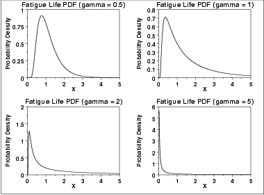
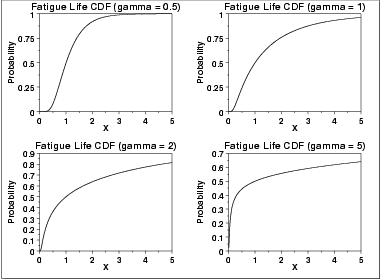
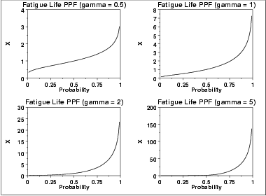
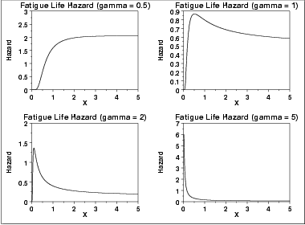
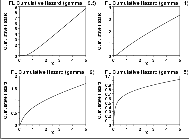
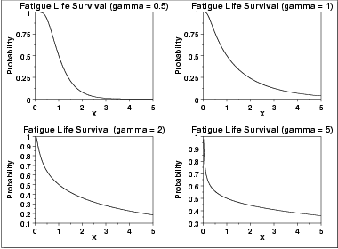
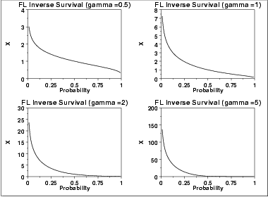

# Birnbaum-Saunders (Fatigue Life) Distribution

Source: [NIST/SEMATECH e-Handbook of Statistical Methods — 1.3.6.6.10. Fatigue Life Distribution](https://www.itl.nist.gov/div898/handbook/eda/section3/eda366a.htm).

Retrieved: 2026-10-25. [Attribution and conversion notes](README.md#source-and-conversion-notes).

## Probability Density Function

The Birnbaum-Saunders distribution is also commonly known as the
fatigue life distribution. There are several alternative
formulations of the Birnbaum-Saunders distribution in the literature.

The general formula for the [probability
density function](https://www.itl.nist.gov/div898/handbook/eda/section3/eda362.htm#PDF) of the Birnbaum-Saunders distribution is

$$
f(x) = \left (\frac{\sqrt{\frac{x-\mu} {\beta}} + \sqrt{\frac{\beta} {x-\mu}}} {2\gamma (x-\mu)} \right) \phi \left( \frac{\sqrt{\frac{x-\mu} {\beta}} - \sqrt{\frac{\beta} {x-\mu}}} {\gamma} \right) \hspace{.2in} x > \mu; \gamma, \beta > 0
$$

where *γ* is the [shape parameter](https://www.itl.nist.gov/div898/handbook/eda/section3/eda363.htm),
*μ* is the [location parameter](https://www.itl.nist.gov/div898/handbook/eda/section3/eda364.htm),
*β* is the [scale parameter](https://www.itl.nist.gov/div898/handbook/eda/section3/eda364.htm),
$\phi$ is the probability density function of the
[standard normal](normal-distribution.md) distribution, and $\Phi$ is
the cumulative distribution function of the [standard
normal](normal-distribution.md) distribution. The case where *μ* = 0 and
*β* = 1 is called the **standard Birnbaum-Saunders
distribution**. The equation for the standard Birnbaum-Saunders
distribution reduces to

$$
f(x) = \left (\frac{\sqrt{x} + \sqrt{\frac{1} {x}}} {2\gamma x} \right) \phi \left (\frac{\sqrt{x} - \sqrt{\frac{1} {x}}} {\gamma} \right) \hspace{.2in} x > 0; \gamma > 0
$$

Since the general form of probability functions can be
[expressed in terms of the standard
distribution](https://www.itl.nist.gov/div898/handbook/eda/section3/eda364.htm#FORMULAS), all subsequent formulas in this section are
given for the standard form of the function.

The following is the plot of the Birnbaum-Saunders probability density
function.

## Cumulative Distribution Function

The formula for the [cumulative distribution
function](https://www.itl.nist.gov/div898/handbook/eda/section3/eda362.htm#CDF) of the Birnbaum-Saunders distribution is

$$
F(x) = \Phi(\frac{\sqrt{x} - \sqrt{\frac{1} {x}}} {\gamma}) \hspace{.2in} x > 0; \gamma > 0
$$

where $\Phi$ is the cumulative distribution function of the
[standard normal](normal-distribution.md) distribution. The following
is the plot of the Birnbaum-Saunders cumulative distribution function
with the same values of γ as the pdf plots above.

## Percent Point Function

The formula for the [percent point
function](https://www.itl.nist.gov/div898/handbook/eda/section3/eda362.htm#PPF) of the Birnbaum-Saunders distribution is

$$
G(p) = \frac{1} {4} \left[\gamma \Phi^{-1}(p) + \sqrt{4 + (\gamma \Phi^{-1}(p))^{2}}\right]^{2}
$$

where $\Phi^{-1}$ is the percent point function of the
[standard normal](normal-distribution.md) distribution. The following is
the plot of the Birnbaum-Saunders percent point function with the same
values of *γ* as the pdf plots above.

## Hazard Function

The Birnbaum-Saunders [hazard function](https://www.itl.nist.gov/div898/handbook/eda/section3/eda362.htm#HAZARD) can
be computed from the Birnbaum-Saunders probability density and cumulative
distribution functions.

The following is the plot of the Birnbaum-Saunders hazard function with
the same values of *γ* as the pdf plots above.

## Cumulative Hazard Function

The Birnbaum-Saunders [cumulative hazard
function](https://www.itl.nist.gov/div898/handbook/eda/section3/eda362.htm#CUMHAZ) can be computed from the Birnbaum-Saunders cumulative
distribution function.

The following is the plot of the Birnbaum-Saunders cumulative hazard
function with the same values of *γ* as the pdf plots above.

## Survival Function

The Birnbaum-Saunders [survival
function](https://www.itl.nist.gov/div898/handbook/eda/section3/eda362.htm#SURVIVAL) can be computed from the Birnbaum-Saunders cumulative
distribution function.

The following is the plot of the Birnbaum-Saunders survival function
with the same values of *γ* as the pdf plots above.

## Inverse Survival Function

The Birnbaum-Saunders [inverse survival
function](https://www.itl.nist.gov/div898/handbook/eda/section3/eda362.htm#INVERSESURVIVAL) can be computed from the Birnbaum-Saunders percent point
function.

The following is the plot of the gamma inverse survival function
with the same values of *γ* as the pdf plots above.

## Common Statistics

The formulas below are with the location parameter equal to zero and
the scale parameter equal to one.

|  |  |
| --- | --- |
| Mean | $1 + \frac{\gamma^{2}} {2}$ |
| Range | 0 to $\infty$. |
| Standard Deviation | $\gamma\sqrt{1 + \frac{5\gamma^{2}} {4}}$ |
| Coefficient of Variation | $\frac{2 + \gamma^{2}} {\gamma\sqrt{1 + 5\gamma^{2}}}$ |

## Parameter Estimation

[Maximum likelihood
estimation for the Birnbaum-Saunders distribution](https://www.itl.nist.gov/div898/handbook/apr/section4/apr413#fatigue life) is discussed
in the [Reliability](https://www.itl.nist.gov/div898/handbook/apr/apr.htm) chapter.

## Comments

The Birnbaum-Saunders distribution is used extensively in
[reliability](https://www.itl.nist.gov/div898/handbook/apr/apr.htm) applications to
model failure times.

## Software

Some general purpose statistical software programs, including
[Dataplot](https://www.itl.nist.gov/div898/handbook/eda/section4/eda44.htm#FLDIST), support at least
some of the probability functions for the Birnbaum-Saunders distribution.
Support for this distribution is likely to be available for
statistical programs that emphasize reliability applications.

The "bs" package implements support for the Birnbaum-Saunders
distribution for the R package. See

Leiva, V., Hernandez, H., and Riquelme, M. (2006). A New Package
for the Birnbaum-Saunders Distribution. *Rnews*, 6/4, 35-40.
(<http://www.r-project.org>)
