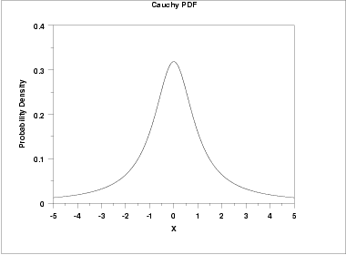
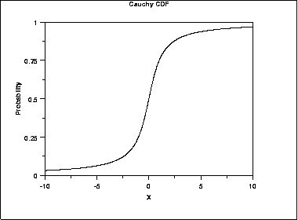
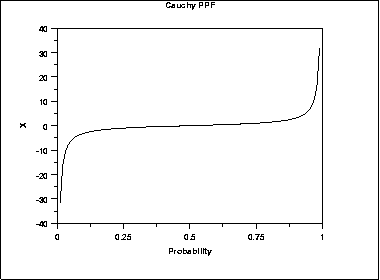
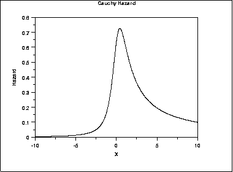
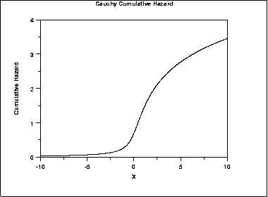
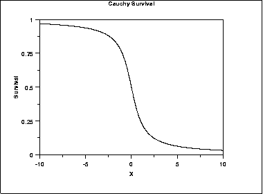
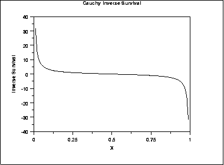

# Cauchy Distribution

Source: [NIST/SEMATECH e-Handbook of Statistical Methods — 1.3.6.6.3. Cauchy Distribution](https://www.itl.nist.gov/div898/handbook/eda/section3/eda3663.htm).

Retrieved: 2026-10-25. [Attribution and conversion notes](README.md#source-and-conversion-notes).

## Probability Density Function

The general formula for the [probability
density function](https://www.itl.nist.gov/div898/handbook/eda/section3/eda362.htm#PDF) of the Cauchy distribution is

$$
f(x) = \frac{1} {s\pi(1 + ((x - t)/s)^{2})}
$$

where ***t*** is the [location
parameter](https://www.itl.nist.gov/div898/handbook/eda/section3/eda364.htm) and ***s*** is the [scale
parameter](https://www.itl.nist.gov/div898/handbook/eda/section3/eda364.htm). The case where ***t*** = 0 and
***s*** = 1 is called the **standard Cauchy distribution**.
The equation for the standard Cauchy distribution reduces to

$$
f(x) = \frac{1} {\pi(1 + x^{2})}
$$

Since the general form of probability functions can be
[expressed in terms of the standard
distribution](https://www.itl.nist.gov/div898/handbook/eda/section3/eda364.htm#FORMULAS), all subsequent formulas in this section are
given for the standard form of the function.

The following is the plot of the standard Cauchy probability density
function.

## Cumulative Distribution Function

The formula for the [cumulative distribution
function](https://www.itl.nist.gov/div898/handbook/eda/section3/eda362.htm#CDF) for the Cauchy distribution is

$$
F(x) = 0.5 + \frac{\arctan{(x)}} {\pi}
$$

The following is the plot of the Cauchy cumulative distribution
function.

## Percent Point Function

The formula for the [percent point
function](https://www.itl.nist.gov/div898/handbook/eda/section3/eda362.htm#PPF) of the Cauchy distribution is

$$
G(p) = -\cot{(\pi p)}
$$

The following is the plot of the Cauchy percent point function.

## Hazard Function

The formula for the Cauchy [hazard
function](https://www.itl.nist.gov/div898/handbook/eda/section3/eda362.htm#HAZARD) is

$$
h(x) = \frac{1} {(1 + x^2)(0.5 \pi - \arctan{x})}
$$

The following is the plot of the Cauchy hazard function.

## Cumulative Hazard Function

The formula for the Cauchy [cumulative hazard
function](https://www.itl.nist.gov/div898/handbook/eda/section3/eda362.htm#CUMHAZ) is

$$
H(x) = -\ln \left( 0.5 - \frac{\arctan{x}}{\pi} \right)
$$

The following is the plot of the Cauchy cumulative hazard function.

## Survival Function

The formula for the Cauchy [survival
function](https://www.itl.nist.gov/div898/handbook/eda/section3/eda362.htm#SURVIVAL) is

$$
S(x) = 0.5 - \frac{\arctan{(x)}} {\pi}
$$

The following is the plot of the Cauchy survival function.

## Inverse Survival Function

The formula for the Cauchy [inverse
survival function](https://www.itl.nist.gov/div898/handbook/eda/section3/eda362.htm#INVERSESURVIVAL) is

$$
Z(p) = -\cot{(\pi (1 - p))}
$$

The following is the plot of the Cauchy inverse survival function.

## Common Statistics

|  |  |
| --- | --- |
| Mean | The mean is undefined. |
| Median | The location parameter *t*. |
| Mode | The location parameter *t*. |
| Range | $-\infty \mbox{ to } \infty$ |
| Standard Deviation | The standard deviation is undefined. |
| Coefficient of Variation | The coefficient of variation is undefined. |
| Skewness | The skewness is 0. |
| Kurtosis | The kurtosis is undefined. |

## Parameter Estimation

The likelihood functions for the Cauchy maximum likelihood
estimates are given in chapter 16 of
[Johnson, Kotz, and Balakrishnan](https://www.itl.nist.gov/div898/handbook/eda/section4/eda43.htm).
These equations typically must be solved numerically on a computer.

## Comments

The Cauchy distribution is important as an example of a
pathological case. Cauchy distributions look similar to a normal
distribution. However, they have much heavier tails.
When studying hypothesis tests that assume normality, seeing how the
tests perform on data from a Cauchy distribution is a good indicator
of how sensitive the tests are to heavy-tail departures from
normality. Likewise, it is a good check for robust techniques
that are designed to work well under a wide variety of
distributional assumptions.

The mean and standard deviation of the Cauchy distribution are
undefined. The practical meaning of this is that collecting
1,000 data points gives no more accurate an estimate of the
mean and standard deviation than does a single point.

## Software

Many general purpose statistical software programs support at least
some of the probability functions for the Cauchy distribution.
