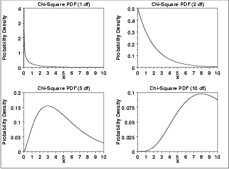
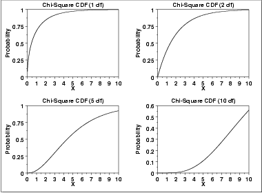
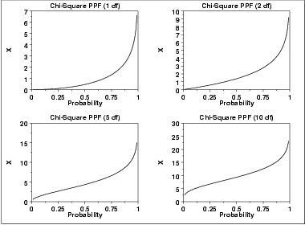

# Chi-Square Distribution

Source: [NIST/SEMATECH e-Handbook of Statistical Methods — 1.3.6.6.6. Chi-Square Distribution](https://www.itl.nist.gov/div898/handbook/eda/section3/eda3666.htm).

Retrieved: 2026-10-25. [Attribution and conversion notes](README.md#source-and-conversion-notes).

## Probability Density Function

The chi-square distribution results when *ν* independent variables
with [standard normal](normal-distribution.md) distributions are squared
and summed. The formula for the [probability
density function](https://www.itl.nist.gov/div898/handbook/eda/section3/eda362.htm#PDF) of the chi-square distribution is

$$
f(x) = \frac{e^{\frac{-x} {2}}x^{\frac{\nu} {2} - 1}} {2^{\frac{\nu} {2}}\Gamma(\frac{\nu} {2}) } \;\;\;\;\;\;\; \mbox{for} \; x \ge 0
$$

where *ν* is the shape parameter and
Γ is the gamma function. The formula for the gamma function is

$$
\Gamma(a) = \int_{0}^{\infty} {t^{a-1}e^{-t}dt}
$$

In a testing context, the chi-square distribution is treated as a
"standardized distribution" (i.e., no location or scale parameters).
However, in a distributional modeling context (as with other
probability distributions), the chi-square distribution itself can be
transformed with a [location parameter](https://www.itl.nist.gov/div898/handbook/eda/section3/eda364.htm),
*μ*, and a [scale parameter](https://www.itl.nist.gov/div898/handbook/eda/section3/eda364.htm),
*σ*.

The following is the plot of the chi-square probability density
function for 4 different values of the shape parameter.

## Cumulative Distribution Function

The formula for the [cumulative distribution
function](https://www.itl.nist.gov/div898/handbook/eda/section3/eda362.htm#PDF) of the chi-square distribution is

$$
F(x) = \frac{\gamma(\frac{\nu} {2},\frac{x} {2})} {\Gamma(\frac{\nu} {2})} \;\;\;\;\;\;\; \mbox{for} \; x \ge 0
$$

where Γ is the gamma function defined above and *γ* is
the incomplete gamma function. The formula for the incomplete gamma
function is

$$
\Gamma_{x}(a) = \int_{0}^{x} {t^{a-1}e^{-t}dt}
$$

The following is the plot of the chi-square cumulative distribution
function with the same values of *ν* as the pdf plots above.

## Percent Point Function

The formula for the [percent point
function](https://www.itl.nist.gov/div898/handbook/eda/section3/eda362.htm#PPF) of the chi-square distribution does not exist in
a simple closed form. It is computed numerically.

The following is the plot of the chi-square percent point function
with the same values of *ν* as the pdf plots above.

## Other Probability Functions

Since the chi-square distribution is typically used to develop
hypothesis tests and confidence intervals and rarely for modeling
applications, we omit the formulas and plots for the hazard,
cumulative hazard, survival, and inverse survival probability
functions.

## Common Statistics

|  |  |
| --- | --- |
| Mean | *ν* |
| Median | approximately *ν* - 2/3 for large *ν* |
| Mode | $\nu - 2 \;\;\;\;\;\;\; \mbox{for} \; \nu > 2$ |
| Range | 0 to $\infty$ |
| Standard Deviation | $\sqrt{2\nu}$ |
| Coefficient of Variation | $\sqrt{\frac{2} {\nu}}$ |
| Skewness | $\frac{2^{1.5} } {\sqrt{\nu}}$ |
| Kurtosis | $3 + \frac{12} {\nu}$ |

## Parameter Estimation

Since the chi-square distribution is typically used to develop hypothesis
tests and confidence intervals and rarely for modeling applications,
we omit any discussion of parameter estimation.

## Comments

The chi-square distribution is used in many cases for the critical
regions for hypothesis tests and in determining confidence intervals.
Two common examples are the
[chi-square test for
independence](https://www.itl.nist.gov/div898/handbook/prc/section4/prc45.htm) in an ***RxC*** contingency table and the
[chi-square test](https://www.itl.nist.gov/div898/handbook/eda/section3/eda358.htm) to determine if the standard
deviation of a population is equal to a pre-specified value.

## Software

Most general purpose statistical software programs support at least
some of the probability functions for the chi-square distribution.
