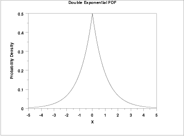
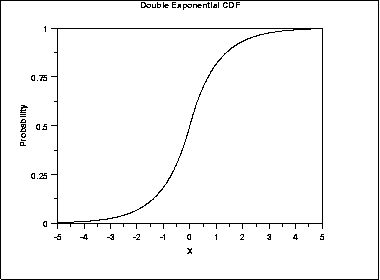
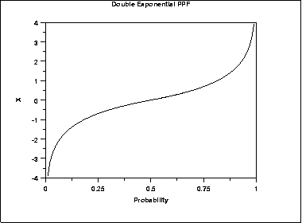
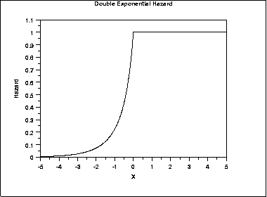
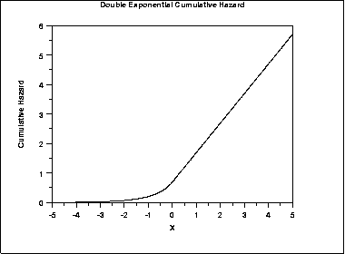
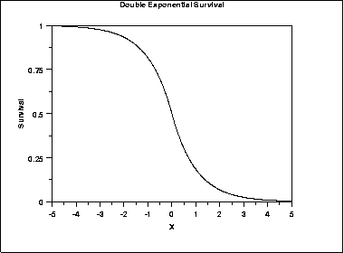
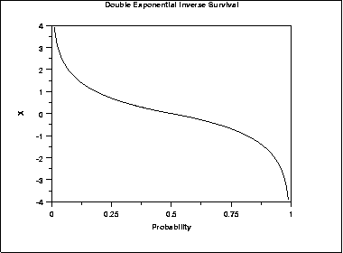

# Double Exponential Distribution

Source: [NIST/SEMATECH e-Handbook of Statistical Methods — 1.3.6.6.12. Double Exponential Distribution](https://www.itl.nist.gov/div898/handbook/eda/section3/eda366c.htm).

Retrieved: 2026-10-25. [Attribution and conversion notes](README.md#source-and-conversion-notes).

## Probability Density Function

The general formula for the [probability
density function](https://www.itl.nist.gov/div898/handbook/eda/section3/eda362.htm#PDF) of the double exponential distribution is

$$
f(x) = \frac{e^{-\left| \frac{x-\mu}{\beta} \right| }} {2\beta}
$$

where *μ* is the [location parameter](https://www.itl.nist.gov/div898/handbook/eda/section3/eda364.htm) and
*β* is the [scale parameter](https://www.itl.nist.gov/div898/handbook/eda/section3/eda364.htm). The case
where *μ* = 0 and *β* = 1 is called the **standard
double exponential distribution**. The equation for the standard double
exponential distribution is

$$
f(x) = \frac{e^{-|x|}} {2}
$$

Since the general form of probability functions can be
[expressed in terms of the standard
distribution](https://www.itl.nist.gov/div898/handbook/eda/section3/eda364.htm#FORMULAS), all subsequent formulas in this section are
given for the standard form of the function.

Note that the double exponential distribution is also commonly
referred to as the Laplace distribution.

The following is the plot of the double exponential probability
density function.

## Cumulative Distribution Function

The formula for the [cumulative distribution
function](https://www.itl.nist.gov/div898/handbook/eda/section3/eda362.htm#CDF) of the double exponential distribution is

$$
F(x) = \begin{array}{ll} \frac{e^{x}} {2} & \mbox{for $x < 0$} \\ 1 - \frac{e^{-x}} {2} & \mbox{for $x \ge 0$} \end{array}
$$

The following is the plot of the double exponential cumulative
distribution function.

## Percent Point Function

The formula for the [percent point
function](https://www.itl.nist.gov/div898/handbook/eda/section3/eda362.htm#PPF) of the double exponential distribution is

$$
G(P) = \begin{array}{ll} \log(2p) & \mbox{for $p \le 0.5$} \\ -\log(2(1 - p)) & \mbox{for $p > 0.5$} \end{array}
$$

The following is the plot of the double exponential percent point
function.

## Hazard Function

The formula for the [hazard function](https://www.itl.nist.gov/div898/handbook/eda/section3/eda362.htm#HAZ) of
the double exponential distribution is

$$
h(x) = \begin{array}{ll} \frac{e^{x}} {2 - e^{x}} & \mbox{for $x < 0$} \\ 1 & \mbox{for $x \ge 0$} \end{array}
$$

The following is the plot of the double exponential hazard function.

## Cumulative Hazard Function

The formula for the [cumulative hazard
function](https://www.itl.nist.gov/div898/handbook/eda/section3/eda362.htm#CUMHAZ) of the double exponential distribution is

$$
H(x) = \begin{array}{ll} -log{(1 - \frac{e^{x}} {2})} & \mbox{for $x < 0$} \\ x + \log{(2)} & \mbox{for $x \ge 0$} \end{array}
$$

The following is the plot of the double exponential cumulative hazard
function.

## Survival Function

The formula for the [survival function](https://www.itl.nist.gov/div898/handbook/eda/section3/eda362.htm#SURVIVAL)
of the double exponential distribution is

$$
S(x) = \begin{array}{ll} 1 - \frac{e^{x}} {2} & \mbox{for $x < 0$} \\ \frac{e^{-x}} {2} & \mbox{for $x \ge 0$} \end{array}
$$

The following is the plot of the double exponential survival function.

## Inverse Survival Function

The formula for the [inverse
survival function](https://www.itl.nist.gov/div898/handbook/eda/section3/eda362.htm#INVERSESURVIVAL) of the double exponential distribution is

$$
Z(P) = \begin{array}{ll} \log(2(1-p)) & \mbox{for $p \le 0.5$} \\ -\log(2p) & \mbox{for $p > 0.5$} \end{array}
$$

The following is the plot of the double exponential inverse survival
function.

## Common Statistics

|  |  |
| --- | --- |
| Mean | *μ* |
| Median | *μ* |
| Mode | *μ* |
| Range | $-\infty \mbox{ to } \infty$ |
| Standard Deviation | $\sqrt{2}\beta$ |
| Skewness | 0 |
| Kurtosis | 6 |
| Coefficient of Variation | $\sqrt{2}(\frac{\beta} {\mu})$ |

## Parameter Estimation

The maximum likelihood estimators of the location and scale
parameters of the double exponential distribution are

$$
\hat{\mu} = \tilde{X}
$$

$$
\hat{\beta} = \frac{\sum_{i=1}^{N}|X_{i} - \tilde{X}|} {N}
$$

where
$\tilde{X}$ is the sample median.

## Software

Some general purpose statistical software programs support at least
some of the probability functions for the double exponential
distribution.
