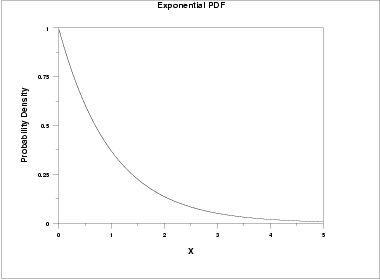
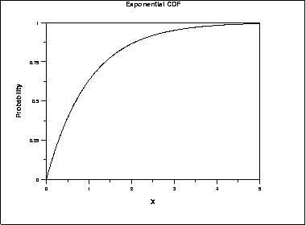
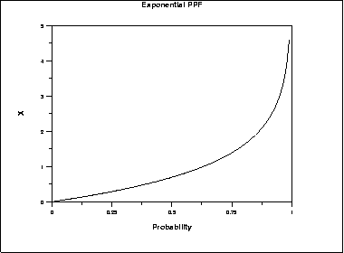
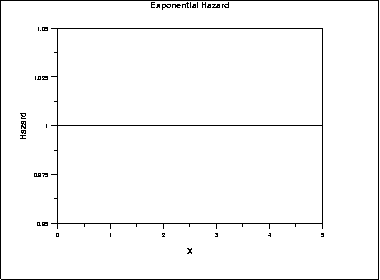
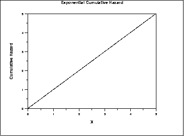
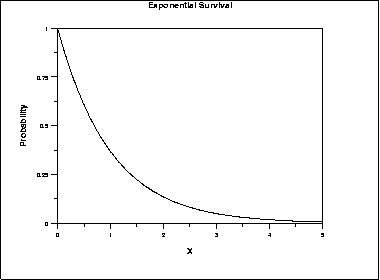
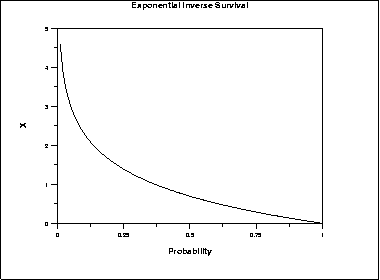

# Exponential Distribution

Source: [NIST/SEMATECH e-Handbook of Statistical Methods — 1.3.6.6.7. Exponential Distribution](https://www.itl.nist.gov/div898/handbook/eda/section3/eda3667.htm).

Retrieved: 2026-10-25. [Attribution and conversion notes](README.md#source-and-conversion-notes).

## Probability Density Function

The general formula for the [probability
density function](https://www.itl.nist.gov/div898/handbook/eda/section3/eda362.htm#PDF) of the exponential distribution is

$$
f(x) = \frac{1} {\beta} e^{-(x - \mu)/\beta} \hspace{.3in} x \ge \mu; \beta > 0
$$

where *μ* is the [location parameter](https://www.itl.nist.gov/div898/handbook/eda/section3/eda364.htm) and
*β* is the [scale parameter](https://www.itl.nist.gov/div898/handbook/eda/section3/eda364.htm) (the scale
parameter is often referred to as *λ* which equals
1/*β*). The case where *μ* = 0 and *β* = 1
is called the **standard exponential distribution**. The equation for
the standard exponential distribution is

$$
f(x) = e^{-x} \;\;\;\;\;\;\; \mbox{for} \; x \ge 0
$$

The general form of probability functions can be
[expressed in terms of the standard
distribution](https://www.itl.nist.gov/div898/handbook/eda/section3/eda364.htm#FORMULAS). Subsequent formulas in this section are
given for the 1-parameter (i.e., with scale parameter) form of the
function.

The following is the plot of the exponential probability density
function.

## Cumulative Distribution Function

The formula for the [cumulative distribution
function](https://www.itl.nist.gov/div898/handbook/eda/section3/eda362.htm#CDF) of the exponential distribution is

$$
F(x) = 1 - e^{-x/\beta} \hspace{.3in} x \ge 0; \beta > 0
$$

The following is the plot of the exponential cumulative distribution
function.

## Percent Point Function

The formula for the [percent point
function](https://www.itl.nist.gov/div898/handbook/eda/section3/eda362.htm#CDF) of the exponential distribution is

$$
G(p) = -\beta\ln(1 - p) \hspace{.3in} 0 \le p < 1; \beta > 0
$$

The following is the plot of the exponential percent point function.

## Hazard Function

The formula for the [hazard
function](https://www.itl.nist.gov/div898/handbook/eda/section3/eda362.htm#CDF) of the exponential distribution is

$$
h(x) = \frac{1} {\beta} \hspace{.3in} x \ge 0; \beta > 0
$$

The following is the plot of the exponential hazard function.

## Cumulative Hazard Function

The formula for the [cumulative hazard
function](https://www.itl.nist.gov/div898/handbook/eda/section3/eda362.htm#CDF) of the exponential distribution is

$$
H(x) = \frac{x} {\beta} \hspace{.3in} x \ge 0; \beta > 0
$$

The following is the plot of the exponential cumulative hazard
function.

## Survival Function

The formula for the [survival
function](https://www.itl.nist.gov/div898/handbook/eda/section3/eda362.htm#CDF) of the exponential distribution is

$$
S(x) = e^{-x/\beta} \hspace{.3in} x \ge 0; \beta > 0
$$

The following is the plot of the exponential survival function.

## Inverse Survival Function

The formula for the [inverse survival
function](https://www.itl.nist.gov/div898/handbook/eda/section3/eda362.htm#CDF) of the exponential distribution is

$$
Z(p) = -\beta\ln(p) \hspace{.3in} 0 \le p < 1; \beta > 0
$$

The following is the plot of the exponential inverse survival function.

## Common Statistics

|  |  |
| --- | --- |
| Mean | $\mu + \beta$ |
| Median | $\mu + \beta\ln{2}$ |
| Mode | *μ* |
| Range | *μ* to $\infty$ |
| Standard Deviation | *β* |
| Coefficient of Variation | 1 |
| Skewness | 2 |
| Kurtosis | 9 |

## Parameter Estimation

For the full sample case, the maximum likelihood estimator of the
scale parameter is the sample mean.
[Maximum likelihood estimation for the exponential distribution](https://www.itl.nist.gov/div898/handbook/apr/section4/apr412.htm#LikelihoodFunctionExamplesforReliabilityData)
is discussed in the chapter on reliability (Chapter 8). It is also
discussed in chapter 19 of
[Johnson, Kotz, and
Balakrishnan](https://www.itl.nist.gov/div898/handbook/eda/section4/eda43.htm#Johnson).

## Comments

The exponential distribution is primarily used in
[reliability](https://www.itl.nist.gov/div898/handbook/apr/apr.htm) applications.
The exponential distribution is used to model data with a
constant failure rate (indicated by the hazard plot which is
simply equal to a constant).

## Software

Most general purpose statistical software programs support at least
some of the probability functions for the exponential distribution.
