# Extreme Value Type I Distribution

Source: [NIST/SEMATECH e-Handbook of Statistical Methods — 1.3.6.6.16. Extreme Value Type I Distribution](https://www.itl.nist.gov/div898/handbook/eda/section3/eda366g.htm).

Retrieved: 2026-10-25. [Attribution and conversion notes](README.md#source-and-conversion-notes).

## Probability Density Function

The extreme value type I distribution has two forms. One is based on
the smallest extreme and the other is based on the largest extreme. We
call these the minimum and maximum cases, respectively. Formulas and
plots for both cases are given. The extreme value type I distribution is
also referred to as the Gumbel distribution.

The general formula for the [probability
density function](https://www.itl.nist.gov/div898/handbook/eda/section3/eda362.htm#PDF) of the Gumbel (minimum) distribution is

$$
f(x) = \frac{1} {\beta} e^{\frac{x-\mu}{\beta}}e^{-e^{\frac{x-\mu} {\beta}}}
$$

where *μ* is the [location parameter](https://www.itl.nist.gov/div898/handbook/eda/section3/eda364.htm) and
*β* is the [scale parameter](https://www.itl.nist.gov/div898/handbook/eda/section3/eda364.htm). The case
where *μ* = 0 and *β* = 1 is called the **standard
Gumbel distribution**. The equation for the standard Gumbel
distribution (minimum) reduces to

$$
f(x) = e^{x}e^{-e^{x}}
$$

The following is the plot of the Gumbel probability density function
for the minimum case.

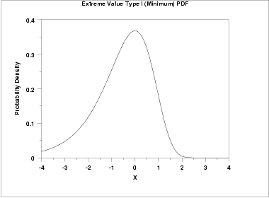

The general formula for the [probability
density function](https://www.itl.nist.gov/div898/handbook/eda/section3/eda362.htm#PDF) of the Gumbel (maximum) distribution is

$$
f(x) = \frac{1}{\beta} e^{-\frac{x-\mu}{\beta}}e^{-e^{-\frac{x-\mu} {\beta}}}
$$

where *μ* is the [location parameter](https://www.itl.nist.gov/div898/handbook/eda/section3/eda364.htm) and
*β* is the [scale parameter](https://www.itl.nist.gov/div898/handbook/eda/section3/eda364.htm). The case
where *μ* = 0 and *β* = 1 is called the **standard
Gumbel distribution**. The equation for the standard Gumbel
distribution (maximum) reduces to

$$
f(x) = e^{-x}e^{-e^{-x}}
$$

The following is the plot of the Gumbel probability density function
for the maximum case.

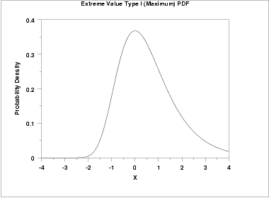

Since the general form of probability functions can be
[expressed in terms of the standard
distribution](https://www.itl.nist.gov/div898/handbook/eda/section3/eda364.htm#FORMULAS), all subsequent formulas in this section are
given for the standard form of the function.

## Cumulative Distribution Function

The formula for the [cumulative distribution
function](https://www.itl.nist.gov/div898/handbook/eda/section3/eda362.htm#CDF) of the Gumbel distribution (minimum) is

$$
F(x) = 1 - e^{-e^{x}}
$$

The following is the plot of the Gumbel cumulative distribution
function for the minimum case.

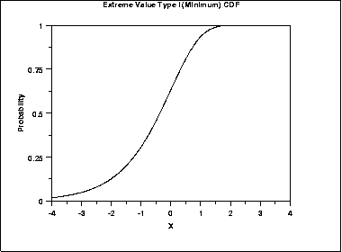

The formula for the [cumulative distribution
function](https://www.itl.nist.gov/div898/handbook/eda/section3/eda362.htm#CDF) of the Gumbel distribution (maximum) is

$$
F(x) = e^{-e^{-x}}
$$

The following is the plot of the Gumbel cumulative distribution
function for the maximum case.

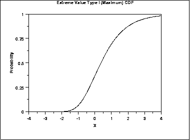

## Percent Point Function

The formula for the [percent point
function](https://www.itl.nist.gov/div898/handbook/eda/section3/eda362.htm#PPF) of the Gumbel distribution (minimum) is

$$
G(p) = \ln(\ln(\frac{1} {1 - p}))
$$

The following is the plot of the Gumbel percent point
function for the minimum case.

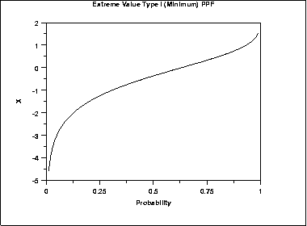

The formula for the [percent point
function](https://www.itl.nist.gov/div898/handbook/eda/section3/eda362.htm#PPF) of the Gumbel distribution (maximum) is

$$
G(p) = -\ln(\ln(\frac{1} {p}))
$$

The following is the plot of the Gumbel percent point
function for the maximum case.

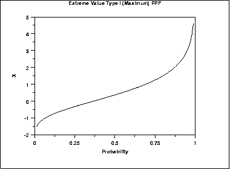

## Hazard Function

The formula for the [hazard
function](https://www.itl.nist.gov/div898/handbook/eda/section3/eda362.htm#HAZ) of the Gumbel distribution (minimum) is

$$
h(x) = e^{x}
$$

The following is the plot of the Gumbel hazard function for
the minimum case.

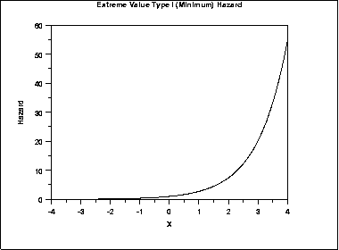

The formula for the [hazard
function](https://www.itl.nist.gov/div898/handbook/eda/section3/eda362.htm#HAZ) of the Gumbel distribution (maximum) is

$$
h(x) = \frac{e^{-x}} {e^{e^{-x}} - 1}
$$

The following is the plot of the Gumbel hazard function for the
maximum case.

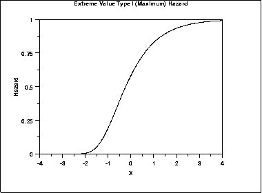

## Cumulative Hazard Function

The formula for the [cumulative hazard
function](https://www.itl.nist.gov/div898/handbook/eda/section3/eda362.htm#CUMHAZ) of the Gumbel distribution (minimum) is

$$
H(x) = e^{x}
$$

The following is the plot of the Gumbel cumulative hazard function for
the minimum case.

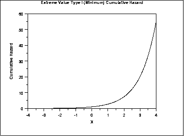

The formula for the [cumulative hazard
function](https://www.itl.nist.gov/div898/handbook/eda/section3/eda362.htm#CUMHAZ) of the Gumbel distribution (maximum) is

$$
H(x) = -\ln(1 - e^{-e^{-x}})
$$

The following is the plot of the Gumbel cumulative hazard
function for the maximum case.

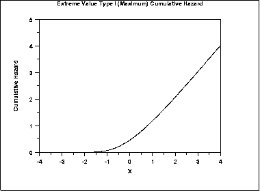

## Survival Function

The formula for the [survival
function](https://www.itl.nist.gov/div898/handbook/eda/section3/eda362.htm#SURVIVAL) of the Gumbel distribution (minimum) is

$$
S(x) = e^{-e^{x}}
$$

The following is the plot of the Gumbel survival function for
the minimum case.

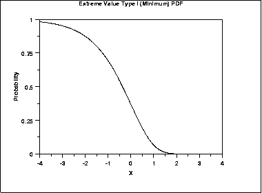

The formula for the [survival
function](https://www.itl.nist.gov/div898/handbook/eda/section3/eda362.htm#SURVIVAL) of the Gumbel distribution (maximum) is

$$
S(x) = 1 - e^{-e^{-x}}
$$

The following is the plot of the Gumbel survival
function for the maximum case.

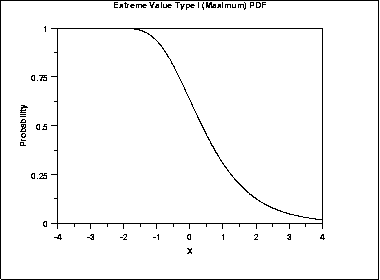

## Inverse Survival Function

The formula for the [inverse
survival function](https://www.itl.nist.gov/div898/handbook/eda/section3/eda362.htm#INVERSESURVIVAL) of the Gumbel distribution (minimum) is

$$
Z(p) = \ln(\ln(\frac{1} {p}))
$$

The following is the plot of the Gumbel inverse survival function for
the minimum case.

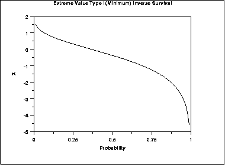

The formula for the [inverse
survival function](https://www.itl.nist.gov/div898/handbook/eda/section3/eda362.htm#INVERSESURVIVAL) of the Gumbel distribution (maximum) is

$$
Z(p) = -\ln(\ln(\frac{1} {1-p}))
$$

The following is the plot of the Gumbel inverse survival
function for the maximum case.

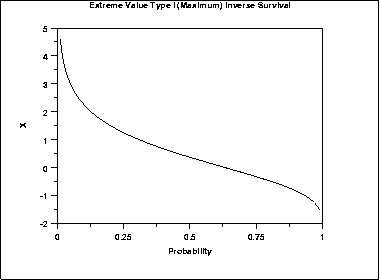

## Common Statistics

The formulas below are for the maximum order statistic case.

|  |  |
| --- | --- |
| Mean | $\mu + 0.5772\beta$ The constant 0.5772 is Euler's number. |
| Median | $\mu - \beta\ln(\ln(2))$ |
| Mode | *μ* |
| Range | $-\infty \mbox{ to } \infty$ |
| Standard Deviation | $\frac{\beta\pi} {\sqrt{6}}$ |
| Skewness | 1.13955 |
| Kurtosis | 5.4 |
| Coefficient of Variation | $\frac {\beta\pi} {\sqrt{6}(\mu + 0.5772\beta)}$ |

## Parameter Estimation

The method of moments estimators of the Gumbel (maximum) distribution
are

$$
\tilde{\beta} = \frac{s\sqrt{6}} {\pi}
$$

$$
\tilde{\mu} = \bar{X} - 0.5772 \tilde{\beta} = \bar{X} - 0.45006 s
$$

where
$\bar{X}$ and ***s*** are the sample mean and standard
deviation, respectively.

The method of moments estimators of the Gumbel (minimum) distribution
are

$$
\tilde{\beta} = \frac{s\sqrt{6}} {\pi}
$$

$$
\tilde{\mu} = \bar{X} + 0.5772 \tilde{\beta} = \bar{X} + 0.45006 s
$$

where
$\bar{X}$ and ***s*** are the sample mean and standard
deviation, respectively.

The maximum likelihood estimates for the maximum case are the solution
to the following simultaneous equations

$$
\bar{x} - \frac{\sum_{i=1}^{n}{x_i \exp(-x_i/\hat{\beta})}} {\sum_{i=1}^{n}{\exp(-x_i/\hat{\beta})}} - \hat{\beta} = 0
$$

$$
-\hat{\beta} \log \left( \frac{1}{n} \sum_{i=1}^{n}{\exp(-x_i/\hat{\beta})} \right) - \hat{\mu} = 0
$$

For the minimum case, replace $-x_i$ with $x_i$ in the above
equations.

These equations need to be solved numerically and this is typically
accomplished by using statistical software packages.

## Software

Some general purpose statistical software programs support at least
some of the probability functions for the extreme value type I
distribution.
