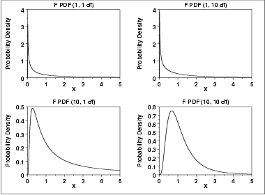
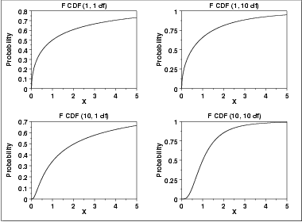
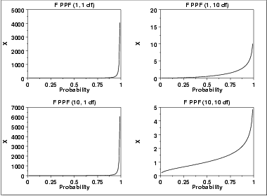

# F Distribution

Source: [NIST/SEMATECH e-Handbook of Statistical Methods — 1.3.6.6.5. F Distribution](https://www.itl.nist.gov/div898/handbook/eda/section3/eda3665.htm).

Retrieved: 2026-10-25. [Attribution and conversion notes](README.md#source-and-conversion-notes).

## Probability Density Function

The F distribution is the ratio of two
[chi-square](chi-square-distribution.md) distributions with degrees of freedom
*ν*1 and *ν*2, respectively, where
each chi-square has first been divided by its degrees of freedom. The
formula for the [probability density
function](https://www.itl.nist.gov/div898/handbook/eda/section3/eda362.htm#PDF) of the F distribution is

$$
f(x) = \frac{\Gamma(\frac{\nu_{1} + \nu_{2}} {2}) (\frac{\nu_{1}} {\nu_{2}})^{\frac{\nu_{1}} {2}} x^{\frac{\nu_{1}} {2} - 1 }} {\Gamma(\frac{\nu_{1}} {2}) \Gamma(\frac{\nu_{2}} {2}) (1 + \frac{\nu_{1}x} {\nu_{2}})^{\frac{\nu_{1} + \nu_{2}} {2}} }
$$
where *ν*1 and *ν*2 are the
shape parameters and
Γ is the gamma function. The formula for the gamma function
is

$$
\Gamma(a) = \int_{0}^{\infty} {t^{a-1}e^{-t}dt}
$$
In a testing context, the F distribution is treated as a
"standardized distribution" (i.e., no location or scale parameters).
However, in a distributional modeling context (as with other
probability distributions), the F distribution itself can be
transformed with a [location parameter](https://www.itl.nist.gov/div898/handbook/eda/section3/eda364.htm),
*μ*, and a [scale parameter](https://www.itl.nist.gov/div898/handbook/eda/section3/eda364.htm),
*σ*.

The following is the plot of the F probability density function for
4 different values of the shape parameters.

## Cumulative Distribution Function

The formula for the [Cumulative distribution
function](https://www.itl.nist.gov/div898/handbook/eda/section3/eda362.htm#PDF) of the F distribution is

$$
F(x) = 1 - I_{k}(\frac{\nu_{2}} {2},\frac{\nu_{1}} {2} )
$$
where *k* =
$$
\nu_2/(\nu_2 + \nu_1 \cdot x)
$$
and ***Ik*** is the incomplete beta
function. The formula for the incomplete beta function is

$$
I_{k}(x,\alpha,\beta) = \frac{\int_{0}^{x} {t^{\alpha-1}(1-t)^{\beta-1}dt}} {B(\alpha,\beta) }
$$

where ***B*** is the beta function

$$
B(\alpha,\beta) = \int_{0}^{1} {t^{\alpha-1}(1-t)^{\beta-1}dt}
$$

The following is the plot of the F cumulative distribution function
with the same values of *ν*1 and
*ν*2 as the pdf plots above.

## Percent Point Function

The formula for the [percent point
function](https://www.itl.nist.gov/div898/handbook/eda/section3/eda362.htm#PPF) of the F distribution does not exist in
a simple closed form. It is computed numerically.

The following is the plot of the F percent point function with the same
values of *ν*1 and *ν*2 as the pdf
plots above.

## Other Probability Functions

Since the F distribution is typically used to develop hypothesis
tests and confidence intervals and rarely for modeling applications,
we omit the formulas and plots for the hazard, cumulative hazard,
survival, and inverse survival probability functions.

## Common Statistics

The formulas below are for the case where the location parameter
is zero and the scale parameter is one.

|  |  |
| --- | --- |
| Mean | $\frac {\nu_{2}} {(\nu_{2} - 2)} \;\;\;\;\;\;\; \nu_{2} > 2$ |
| Mode | $\frac {\nu_{2}(\nu_{1} - 2)} {\nu_{1}(\nu_{2} + 2)} \;\;\;\;\;\;\; \nu_{1} > 2$ |
| Range | 0 to $\infty$ |
| Standard Deviation | $\sqrt{\frac {2\nu_{2}^{2}(\nu_{1} + \nu_{2} - 2)} {\nu_{1}(\nu_{2} - 2)^{2}(\nu_{2} - 4)}} \;\;\;\;\;\;\; \nu_{2} > 4$ |
| Coefficient of Variation | $\sqrt{\frac{2(\nu_{1} + \nu_{2} - 2)} {\nu_{1}(\nu_{2} - 4)}} \;\;\;\;\;\;\; \nu_{2} > 4$ |
| Skewness | $\frac {(2\nu_{1} + \nu_{2} - 2)\sqrt{8(\nu_{2} - 4)}} {\sqrt{\nu_{1}}(\nu_{2} - 6)\sqrt{(\nu_{1} + \nu_{2} - 2)}} \;\;\;\;\;\;\; \nu_{2} > 6$ |

## Parameter Estimation

Since the F distribution is typically used to develop hypothesis
tests and confidence intervals and rarely for modeling applications,
we omit any discussion of parameter estimation.

## Comments

The F distribution is used in many cases for the critical regions
for hypothesis tests and in determining confidence intervals.
Two common examples are the
[analysis of variance](https://www.itl.nist.gov/div898/handbook/prc/section4/prc42.htm)
and the [F test](https://www.itl.nist.gov/div898/handbook/eda/section3/eda359.htm) to determine if the
variances of two populations are equal.

## Software

Most general purpose statistical software programs support at least
some of the probability functions for the F distribution.
