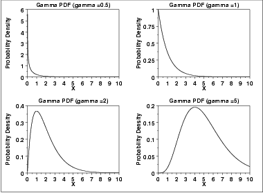
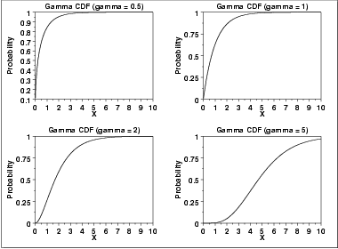
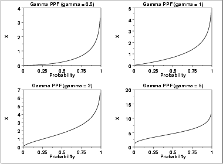
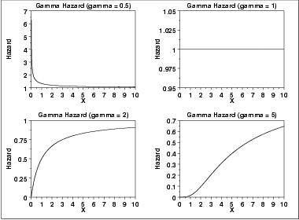
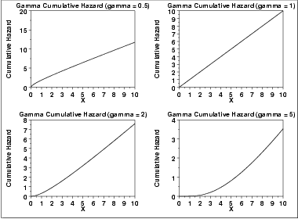
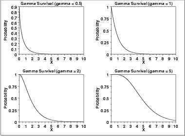
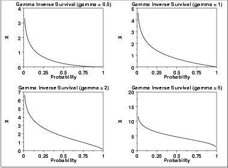

# Gamma Distribution

Source: [NIST/SEMATECH e-Handbook of Statistical Methods — 1.3.6.6.11. Gamma Distribution](https://www.itl.nist.gov/div898/handbook/eda/section3/eda366b.htm).

Retrieved: 2026-10-25. [Attribution and conversion notes](README.md#source-and-conversion-notes).

## Probability Density Function

The general formula for the [probability
density function](https://www.itl.nist.gov/div898/handbook/eda/section3/eda362.htm#PDF) of the gamma distribution is

$$
f(x) = \frac{(\frac{x-\mu}{\beta})^{\gamma - 1}\exp{(-\frac{x-\mu} {\beta}})} {\beta\Gamma(\gamma)} \hspace{.2in} x \ge \mu; \gamma, \beta > 0
$$

where *γ* is the [shape parameter](https://www.itl.nist.gov/div898/handbook/eda/section3/eda363.htm),
*μ* is the [location parameter](https://www.itl.nist.gov/div898/handbook/eda/section3/eda364.htm),
*β* is the [scale parameter](https://www.itl.nist.gov/div898/handbook/eda/section3/eda364.htm), and Γ
is the gamma function which has the formula

$$
\Gamma(a) = \int_{0}^{\infty} {t^{a-1}e^{-t}dt}
$$

The case where *μ* = 0 and *β* = 1 is called the
**standard gamma distribution**. The equation for the standard gamma
distribution reduces to

$$
f(x) = \frac{x^{\gamma - 1}e^{-x}} {\Gamma(\gamma)} \hspace{.2in} x \ge 0; \gamma > 0
$$

Since the general form of probability functions can be
[expressed in terms of the standard
distribution](https://www.itl.nist.gov/div898/handbook/eda/section3/eda364.htm#FORMULAS), all subsequent formulas in this section are
given for the standard form of the function.

The following is the plot of the gamma probability density function.

## Cumulative Distribution Function

The formula for the [cumulative distribution
function](https://www.itl.nist.gov/div898/handbook/eda/section3/eda362.htm#CDF) of the gamma distribution is

$$
F(x) = \frac{\Gamma_{x}(\gamma)} {\Gamma(\gamma)} \hspace{.2in} x \ge 0; \gamma > 0
$$

where Γ is the gamma function defined above and
$\Gamma_{x}(a)$ is the incomplete gamma function. The incomplete gamma
function has the formula

$$
\Gamma_{x}(a) = \int_{0}^{x} {t^{a-1}e^{-t}dt}
$$

The following is the plot of the gamma cumulative distribution
function with the same values of *γ* as the pdf plots above.

## Percent Point Function

The formula for the [percent point
function](https://www.itl.nist.gov/div898/handbook/eda/section3/eda362.htm#PPF) of the gamma distribution does not exist in a simple
closed form. It is computed numerically.

The following is the plot of the gamma percent point function with
the same values of *γ* as the pdf plots above.

## Hazard Function

The formula for the [hazard
function](https://www.itl.nist.gov/div898/handbook/eda/section3/eda362.htm#HAZ) of the gamma distribution is

$$
h(x) = \frac{x^{\gamma - 1}e^{-x}} {\Gamma(\gamma) - \Gamma_{x}(\gamma)} \hspace{.2in} x \ge 0; \gamma > 0
$$

The following is the plot of the gamma hazard function with the same
values of *γ* as the pdf plots above.

## Cumulative Hazard Function

The formula for the [cumulative hazard
function](https://www.itl.nist.gov/div898/handbook/eda/section3/eda362.htm#CUMHAZ) of the gamma distribution is

$$
H(x) = -\log{(1 - \frac{\Gamma_{x}(\gamma)} {\Gamma(\gamma)})} \hspace{.2in} x \ge 0; \gamma > 0
$$

where Γ is the gamma function defined above and
$\Gamma_{x}(a)$ is the incomplete gamma function defined above.

The following is the plot of the gamma cumulative hazard function with
the same values of *γ* as the pdf plots above.

## Survival Function

The formula for the [survival function](https://www.itl.nist.gov/div898/handbook/eda/section3/eda362.htm#SURVIVAL)
of the gamma distribution is

$$
S(x) = 1 - \frac{\Gamma_{x}(\gamma)} {\Gamma(\gamma)} \hspace{.2in} x \ge 0; \gamma > 0
$$

where Γ is the gamma function defined above and
$\Gamma_{x}(a)$ is the incomplete gamma function defined above.

The following is the plot of the gamma survival function with the same
values of *γ* as the pdf plots above.

## Inverse Survival Function

The gamma [inverse survival
function](https://www.itl.nist.gov/div898/handbook/eda/section3/eda362.htm#INVERSESURVIVAL) does not exist in simple closed form. It is computed
numberically.

The following is the plot of the gamma inverse survival function with
the same values of *γ* as the pdf plots above.

## Common Statistics

The formulas below are with the location parameter equal to zero and
the scale parameter equal to one.

|  |  |
| --- | --- |
| Mean | *γ* |
| Mode | *γ*- 1      *γ* ≥ 1 |
| Range | 0 to $\infty$. |
| Standard Deviation | $\sqrt{\gamma}$ |
| Skewness | $\frac{2} {\sqrt{\gamma}}$ |
| Kurtosis | $3 + \frac{6} {\gamma}$ |
| Coefficient of Variation | $\frac{1} {\sqrt{\gamma}}$ |

## Parameter Estimation

The method of moments estimators of the 2-parameter gamma distribution
are

$$
\hat{\gamma} = (\frac{\bar{x}} {s})^{2}
$$

$$
\hat{\beta} = \frac{s^{2}} {\bar{x}}
$$

where
$\bar{x}$ and ***s*** are the sample mean and standard
deviation, respectively.

The maximum likelihood estimates for the 2-parameter gamma
distribution are the solutions of the following simultaneous
equations

$$
\hat{\beta} - \frac{\bar{x}}{\hat{\gamma}} = 0
$$

$$
\log{\hat{\gamma}} - \psi(\hat{\gamma}) - \log \left( \frac{\bar{x}} { \left( \prod_{i=1}^{n}{x_i} \right) ^{1/n} } \right) = 0
$$

with ψ denoting the digamma function. These equations need to be
solved numerically; this is typically accomplished by using statistical
software packages.

## Software

Some general purpose statistical software programs support at least
some of the probability functions for the gamma distribution.
