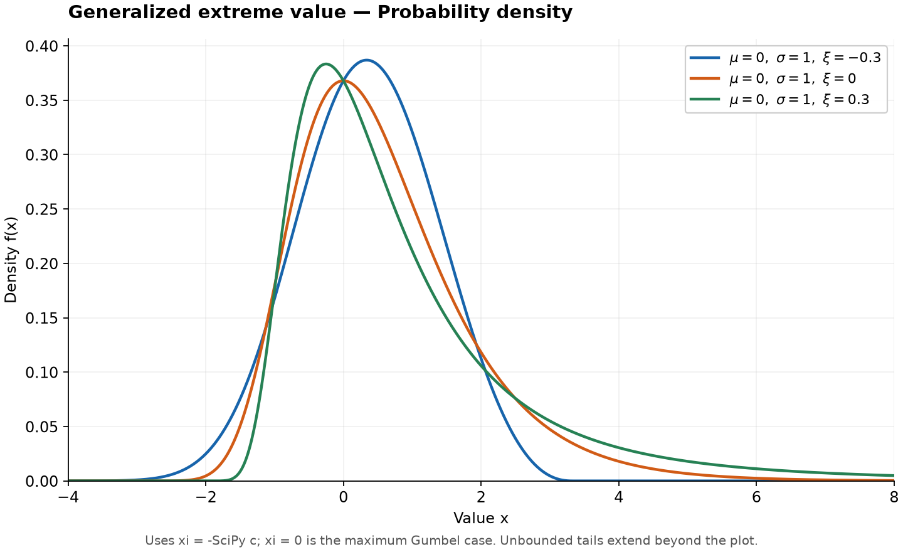
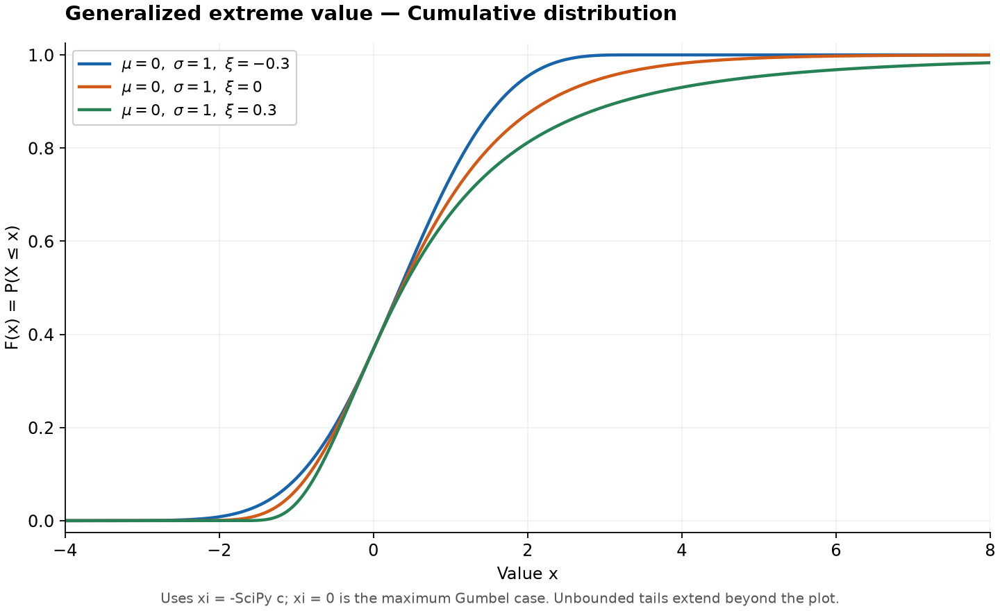

# Generalized Extreme Value Distribution

Original guide. Reference: [SciPy `genextreme`](https://docs.scipy.org/doc/scipy/reference/generated/scipy.stats.genextreme.html), checked 2026-10-25. [Collection notes](README.md#source-and-conversion-notes).

## Use and parameters

A family for block maxima, such as the largest observation each year. Parameters are location $\mu$, scale $\sigma>0$, and shape $\xi$. Write $z=(x-\mu)/\sigma$ and $t=1+\xi z$.

## Probability Density and Cumulative Distribution Functions

For $\xi\ne0$, on $t>0$,

$$
f(x)=\frac1\sigma t^{-1/\xi-1}e^{-t^{-1/\xi}},\qquad F(x)=e^{-t^{-1/\xi}}.
$$

For $\xi>0$, $F=0$ below the lower endpoint. For $\xi<0$, $F=1$ above the upper endpoint. Endpoint values follow by continuity.

At $\xi=0$, use the Gumbel limit on the real line:

$$
f(x)=\sigma^{-1}e^{-z-e^{-z}},\qquad F(x)=e^{-e^{-z}}.
$$

## Percent Point Function

For $0<q<1$,

$$
Q(q)=\begin{cases}
\mu+\sigma[(-\log q)^{-\xi}-1]/\xi,&\xi\ne0,\\
\mu-\sigma\log(-\log q),&\xi=0.
\end{cases}
$$

## Common Statistics

The mean is finite for $\xi<1$; variance is finite for $\xi<1/2$. Positive shape gives a heavy upper tail; negative shape gives a finite upper endpoint.

## Estimation and software

Fit numerically. SciPy uses the opposite shape sign: `scipy.stats.genextreme(c=-xi, loc=mu, scale=sigma)`.

## Related distributions

At $\xi=0$, this is the maximum form of [Extreme Value Type I (Gumbel)](extreme-value-type-i-distribution.md).
