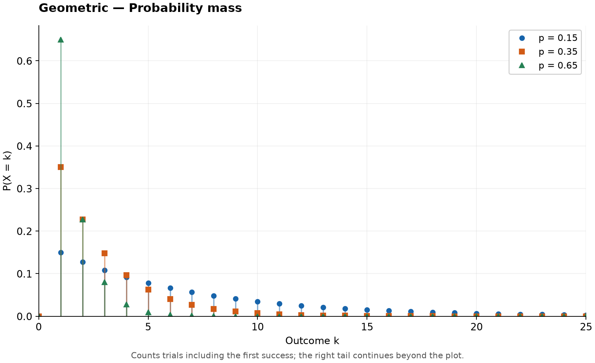
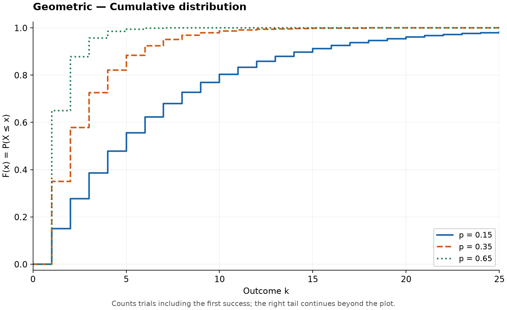

# Geometric Distribution

Original guide. Reference: [SciPy `geom`](https://docs.scipy.org/doc/scipy/reference/generated/scipy.stats.geom.html), checked 2026-10-25. [Collection notes](README.md#source-and-conversion-notes).

## Use and parameters

Counts independent trials up to and including the first success. The success probability is $0<p\le1$; support is $k=1,2,\ldots$. For example, model how many attempts a task needs when each attempt has the same success probability.

## Probability Mass Function

$$
P(X=k)=p(1-p)^{k-1},\qquad k=1,2,\ldots
$$

At $p=1$, $X=1$ with certainty.

## Cumulative Distribution Function

For $x\ge1$,

$$
F(x)=1-(1-p)^{\lfloor x\rfloor}.
$$

Below one, $F(x)=0$. For $0<p<1$ and $0<q<1$,

$$
Q(q)=\left\lceil\frac{\log(1-q)}{\log(1-p)}\right\rceil.
$$

## Common Statistics

| Statistic | Value |
| --- | --- |
| Mean | $1/p$ |
| Variance | $(1-p)/p^2$ |
| Mode | 1 |

## Estimation and software

The maximum likelihood estimate is $\hat p=1/\bar x$. Use `scipy.stats.geom(p)`.

With $p=0.25$, the expected wait is four trials. The distribution is memoryless.

## Related distributions

Counting failures instead gives $Y=X-1$, supported on zero upward. This equals [negative binomial](negative-binomial-distribution.md) with $r=1$. The [exponential](exponential-distribution.md) is the continuous memoryless counterpart.
