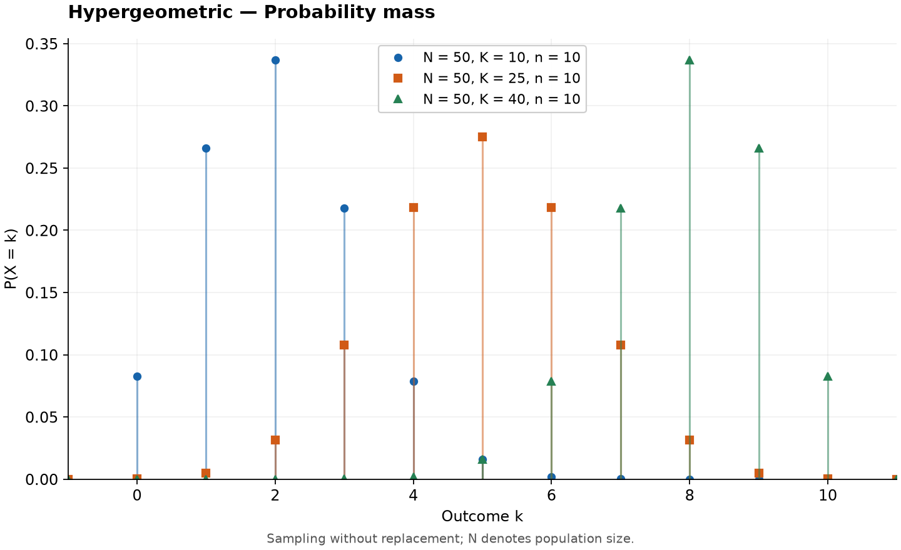
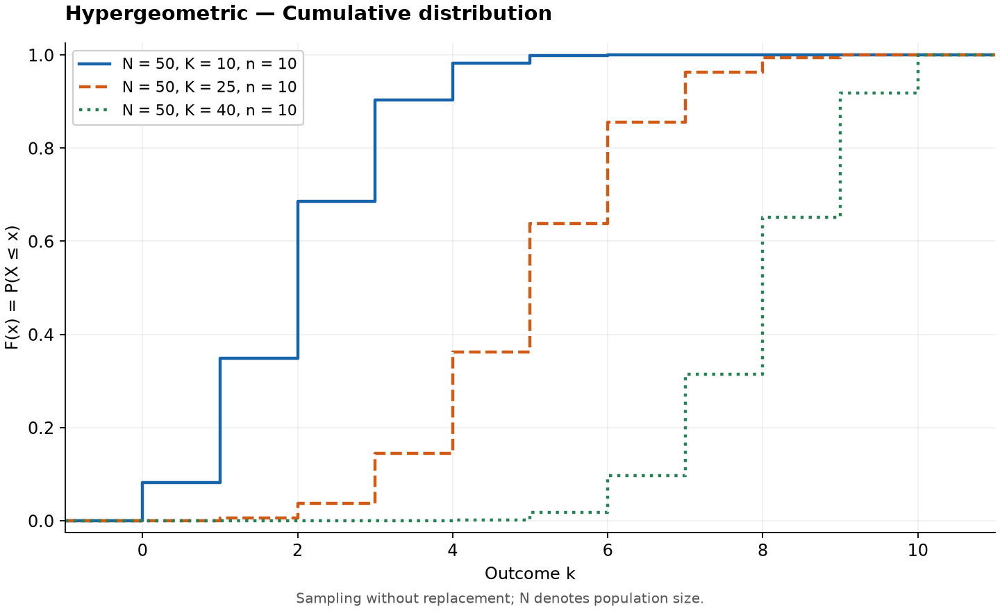

# Hypergeometric Distribution

Original guide. Reference: [SciPy `hypergeom`](https://docs.scipy.org/doc/scipy/reference/generated/scipy.stats.hypergeom.html), checked 2026-10-25. [Collection notes](README.md#source-and-conversion-notes).

## Use and parameters

Counts successes in a uniform sample drawn without replacement from a finite population. Let $N\ge1$ be population size, $K$ the number of successes, and $n$ the sample size. These are integers with $0\le K,n\le N$.

Support runs from $L=\max(0,n-N+K)$ to $U=\min(n,K)$.

## Probability Mass Function

$$
P(X=k)=\frac{\binom Kk\binom{N-K}{n-k}}{\binom Nn},\qquad L\le k\le U.
$$

## Cumulative Distribution Function

$$
F(x)=\sum_{k=L}^{\min(U,\lfloor x\rfloor)}P(X=k).
$$

The empty sum is zero. Quantiles are the smallest supported integer with $F(k)\ge q$.

## Common Statistics

| Statistic | Value |
| --- | --- |
| Mean | $nK/N$ |
| Variance, $N>1$ | $n(K/N)(1-K/N)(N-n)/(N-1)$ |

For $N=1$ the outcome is deterministic and variance is zero.

## Estimation and software

Parameters usually describe a known sampling design. SciPy uses different names: `scipy.stats.hypergeom(M=N, n=K, N=n)`.

For five cards drawn from a standard deck, $N=52$, $K=4$, $n=5$ counts aces; the mean is $5/13$.

## Related distributions

The [binomial](binomial-distribution.md) assumes independent draws with a constant success probability. Its approximation improves when the sampling fraction is small.
