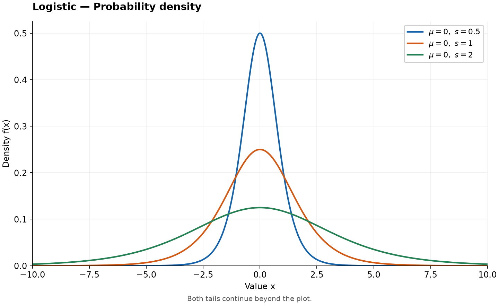
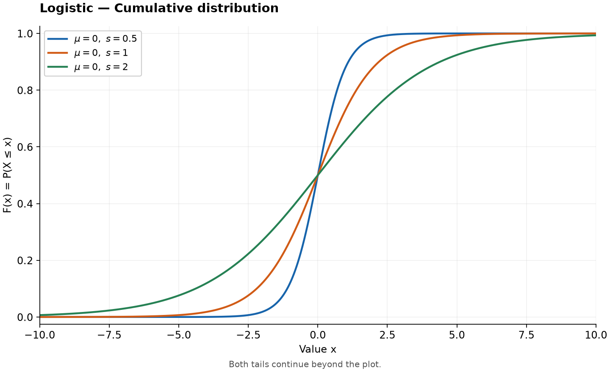

# Logistic Distribution

Original guide. Reference: [SciPy `logistic`](https://docs.scipy.org/doc/scipy/reference/generated/scipy.stats.logistic.html), checked 2026-10-25. [Collection notes](README.md#source-and-conversion-notes).

## Use and parameters

A symmetric bell shape with heavier tails than a normal distribution of the same variance. Its CDF is the familiar sigmoid. Parameters are location $\mu\in\mathbb R$ and scale $s>0$; support is the entire real line. Scale is not the standard deviation.

## Probability Density Function

Writing $z=(x-\mu)/s$,

$$
f(x)=\frac{e^{-z}}{s(1+e^{-z})^2}.
$$

## Cumulative Distribution and Quantile Functions

$$
F(x)=\frac1{1+e^{-z}},\qquad Q(q)=\mu+s\log\frac q{1-q},\quad 0<q<1.
$$

## Common Statistics

| Statistic | Value |
| --- | --- |
| Mean, median, mode | $\mu$ |
| Variance | $\pi^2s^2/3$ |
| Skewness | 0 |
| Excess kurtosis | $6/5$ |

## Estimation and software

Moment estimates are $\hat\mu=\bar x$ and $\hat s=\sqrt{3v}/\pi$, where $v$ is the sample second central moment. Numerical maximum likelihood is available through `scipy.stats.logistic.fit(data)`.

For $\mu=0,s=1$, the median is zero and $Q(0.75)=\log3$.

## Related distributions

Compare tail shapes with [normal](normal-distribution.md) and [double exponential (Laplace)](double-exponential-distribution.md). [Tukey–Lambda](tukey-lambda-distribution.md) approaches standard logistic as its shape approaches zero.
