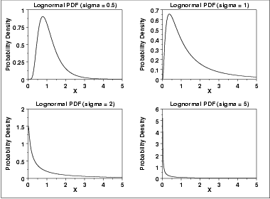
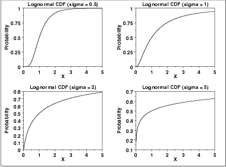
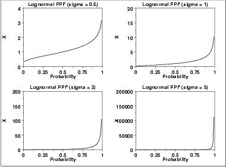
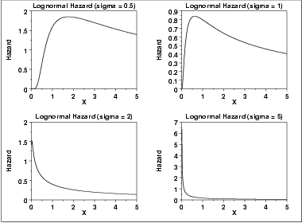
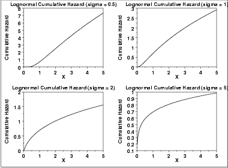
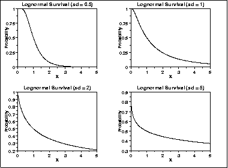
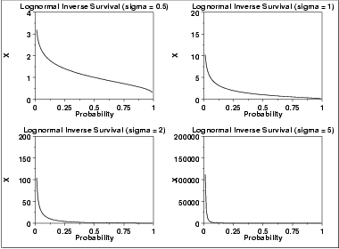

# Lognormal Distribution

Source: [NIST/SEMATECH e-Handbook of Statistical Methods — 1.3.6.6.9. Lognormal Distribution](https://www.itl.nist.gov/div898/handbook/eda/section3/eda3669.htm).

Retrieved: 2026-10-25. [Attribution and conversion notes](README.md#source-and-conversion-notes).

## Probability Density Function

A variable *X* is lognormally distributed if $Y = \ln(X)$ is
normally distributed with "LN" denoting the natural logarithm.
The general formula for the [probability
density function](https://www.itl.nist.gov/div898/handbook/eda/section3/eda362.htm#PDF) of the lognormal distribution is

$$
f(x) = \frac{e^{-((\ln((x-\theta)/m))^{2}/(2\sigma^{2}))}} {(x-\theta)\sigma\sqrt{2\pi}} \hspace{.2in} x > \theta; m, \sigma > 0
$$

where *σ* is the [shape parameter](https://www.itl.nist.gov/div898/handbook/eda/section3/eda363.htm)
(and is the standard deviation of the log of the distribution),
*θ* is the [location parameter](https://www.itl.nist.gov/div898/handbook/eda/section3/eda364.htm) and
*m* is the [scale parameter](https://www.itl.nist.gov/div898/handbook/eda/section3/eda364.htm) (and is also the
median of the distribution). If *x* = *θ*, then
*f*(*x*) = 0. The case where *θ* = 0 and
*m* = 1 is called the **standard lognormal distribution**. The
case where *θ* equals zero is called the 2-parameter lognormal
distribution.

The equation for the standard lognormal distribution is

$$
f(x) = \frac{e^{-((\ln x)^{2}/2\sigma^{2})}} {x\sigma\sqrt{2\pi}} \hspace{.2in} x > 0; \sigma > 0
$$

Since the general form of probability functions can be
[expressed in terms of the standard
distribution](https://www.itl.nist.gov/div898/handbook/eda/section3/eda364.htm#FORMULAS), all subsequent formulas in this section are
given for the standard form of the function.

Note that the lognormal distribution is commonly parameterized
with

$$
\mu = \log(m)
$$

The *μ* parameter is the mean of the log of the distribution. If
the *μ* parameterization is used, the lognormal pdf is

$$
f(x) = \frac{e^{-(\ln(x - \theta) - \mu)^2/(2\sigma^2)}} {(x - \theta)\sigma\sqrt{2\pi}} \hspace{.2in} x > \theta; \sigma > 0
$$

We prefer to use the *m* parameterization since *m* is an
explicit scale parameter.

The following is the plot of the lognormal probability density
function for four values of *σ*.

There are several common parameterizations of the lognormal
distribution. The form given here is from
[Evans, Hastings, and
Peacock](https://www.itl.nist.gov/div898/handbook/eda/section4/eda43.htm#Evans).

## Cumulative Distribution Function

The formula for the [cumulative distribution
function](https://www.itl.nist.gov/div898/handbook/eda/section3/eda362.htm#CDF) of the lognormal distribution is

$$
F(x) = \Phi(\frac{\ln(x)} {\sigma}) \hspace{.2in} x \ge 0; \sigma > 0
$$

where $\Phi$ is the [cumulative distribution
function of the normal distribution](normal-distribution.md#CDF).

The following is the plot of the lognormal cumulative distribution
function with the same values of *σ* as the pdf plots above.

## Percent Point Function

The formula for the [percent point
function](https://www.itl.nist.gov/div898/handbook/eda/section3/eda362.htm#PPF) of the lognormal distribution is

$$
G(p) = \exp(\sigma\Phi^{-1}(p)) \hspace{.2in} 0 \le p < 1; \sigma > 0
$$

where $\Phi^{-1}$ is the [percent point
function of the normal distribution](normal-distribution.md#PPF).

The following is the plot of the lognormal percent point function with
the same values of *σ* as the pdf plots above.

## Hazard Function

The formula for the [hazard
function](https://www.itl.nist.gov/div898/handbook/eda/section3/eda362.htm#HAZARD) of the lognormal distribution is

$$
h(x,\sigma) = \frac{(\frac{1} {x\sigma})\phi(\frac{\ln x} {\sigma})} {\Phi(\frac{-\ln x} {\sigma})} \hspace{.2in} x > 0; \sigma > 0
$$

where $\phi$ is the [probability density
function of the normal distribution](normal-distribution.md#PDF) and $\Phi$ is the
[cumulative distribution function of the
normal distribution](normal-distribution.md#CDF).

The following is the plot of the lognormal hazard function with the
same values of *σ* as the pdf plots above.

## Cumulative Hazard Function

The formula for the [cumulative
hazard function](https://www.itl.nist.gov/div898/handbook/eda/section3/eda362.htm#CUMHAZ) of the lognormal distribution is

$$
H(x) = -\ln(1 - \Phi(\frac{\ln(x)} {\sigma})) \hspace{.2in} x \ge 0; \sigma > 0
$$

where $\Phi$ is the [cumulative distribution
function of the normal distribution](normal-distribution.md#CDF).

The following is the plot of the lognormal cumulative hazard function
with the same values of *σ* as the pdf plots above.

## Survival Function

The formula for the [survival function](https://www.itl.nist.gov/div898/handbook/eda/section3/eda362.htm#SURVIVAL)
of the lognormal distribution is

$$
S(x) = 1 - \Phi(\frac{\ln(x)} {\sigma}) \hspace{.2in} x \ge 0; \sigma > 0
$$

where $\Phi$ is the [cumulative distribution
function of the normal distribution](normal-distribution.md#CDF).

The following is the plot of the lognormal survival function
with the same values of *σ* as the pdf plots above.

## Inverse Survival Function

The formula for the [inverse
survival function](https://www.itl.nist.gov/div898/handbook/eda/section3/eda362.htm#INVERSESURVIVAL) of the lognormal distribution is

$$
Z(p) = \exp(\sigma\Phi^{-1}(1-p)) \hspace{.2in} 0 \le p < 1; \sigma > 0
$$

where $\Phi^{-1}$ is the [percent point
function of the normal distribution](normal-distribution.md#PPF).

The following is the plot of the lognormal inverse survival function
with the same values of *σ* as the pdf plots above.

## Common Statistics

The formulas below are with the location parameter equal to zero
and the scale parameter equal to one.

|  |  |
| --- | --- |
| Mean | $e^{0.5\sigma^{2}}$ |
| Median | Scale parameter *m* (= 1 if scale parameter not specified). |
| Mode | $\frac{1} {e^{\sigma^{2}}}$ |
| Range | 0 to $\infty$ |
| Standard Deviation | $\sqrt{e^{\sigma^{2}} (e^{\sigma^{2}} - 1)}$ |
| Skewness | $(e^{\sigma^{2}}+2) \sqrt{e^{\sigma^{2}} - 1}$ |
| Kurtosis | $(e^{\sigma^{2}})^{4} + 2(e^{\sigma^{2}})^{3} + 3(e^{\sigma^{2}})^{2} - 3$ |
| Coefficient of Variation | $\sqrt{e^{\sigma^{2}} - 1}$ |

## Parameter Estimation

The maximum likelihood estimates for the scale parameter,
***m***, and the shape parameter, σ, are

$$
\hat{m} = \exp{\hat{\mu}}
$$
and

$$
\hat{\sigma} = \sqrt{\frac{\sum_{i=1}^{N}{(\ln{(X_{i})} - \hat{\mu})^{2}}} {N}}
$$
where

$$
\hat{\mu}= \frac{\sum_{i=1}^{N}{\ln{X_i}}} {N}
$$
If the location parameter is known, it can be subtracted from the
original data points before computing the maximum likelihood estimates
of the shape and scale parameters.

## Comments

The lognormal distribution is used extensively in
[reliability](https://www.itl.nist.gov/div898/handbook/apr/apr.htm) applications to
model failure times. The lognormal and
[Weibull](weibull-distribution.md) distributions are probably the
most commonly used distributions in reliability applications.

## Software

Most general purpose statistical software programs support at least
some of the probability functions for the lognormal distribution.
