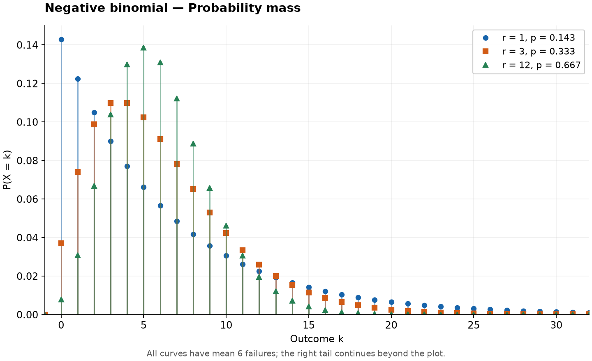
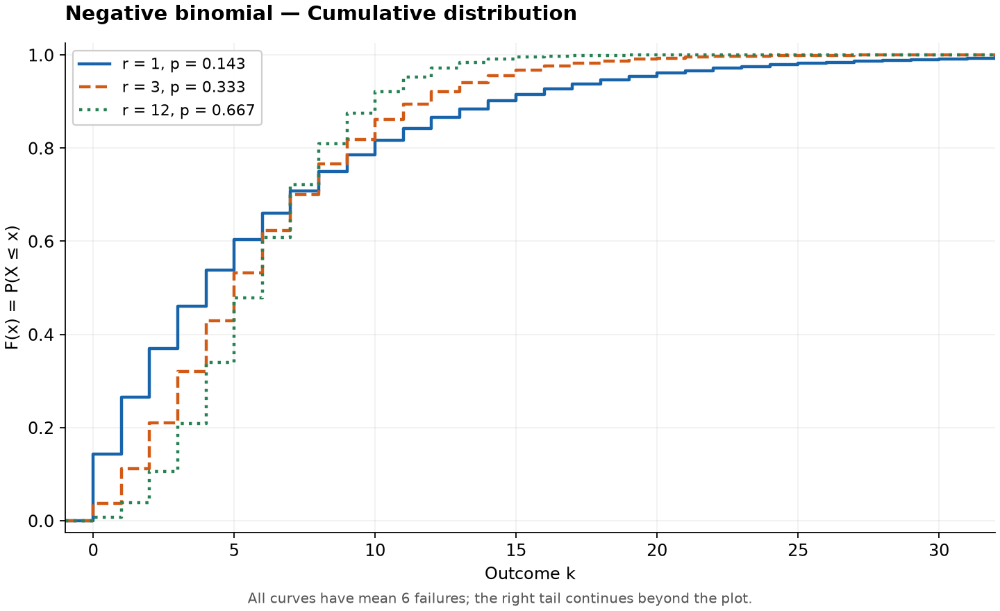

# Negative Binomial Distribution

Original guide. Reference: [SciPy `nbinom`](https://docs.scipy.org/doc/scipy/reference/generated/scipy.stats.nbinom.html), checked 2026-10-25. [Collection notes](README.md#source-and-conversion-notes).

## Use and parameters

Counts failures before the $r$th success, with independent trials and success probability $0<p\le1$. The trial interpretation requires positive integer $r$; the distribution extends to real $r>0$. Support is $k=0,1,\ldots$.

It also models counts whose variance exceeds their mean.

## Probability Mass Function

$$
P(X=k)=\frac{\Gamma(k+r)}{\Gamma(r)\,k!}p^r(1-p)^k.
$$

At $p=1$, all mass is at zero.

## Cumulative Distribution Function

For $x\ge0$,

$$
F(x)=I_p(r,\lfloor x\rfloor+1),
$$

where $I$ is the regularized incomplete beta function. Below zero, $F(x)=0$. Quantiles are computed numerically as the smallest integer $k$ with $F(k)\ge q$.

## Common Statistics

| Statistic | Value |
| --- | --- |
| Mean | $\mu=r(1-p)/p$ |
| Variance | $r(1-p)/p^2=\mu+\mu^2/r$ |

## Estimation and software

With sample mean $m>0$ and moment variance $v>m$, moment estimates are $\hat r=m^2/(v-m)$ and $\hat p=m/v$. Joint maximum likelihood needs numerical optimization. Use `scipy.stats.nbinom(r, p)`; it counts failures, not total trials.

## Related distributions

At $r=1$, $X+1$ is [geometric](geometric-distribution.md). Increasing $r$ at fixed mean approaches [Poisson](poisson-distribution.md).
