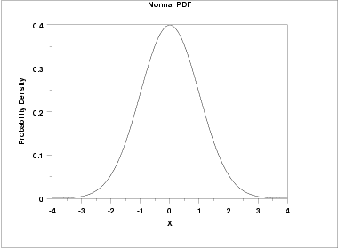
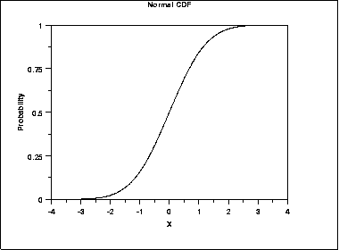
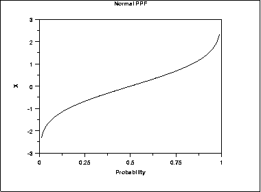
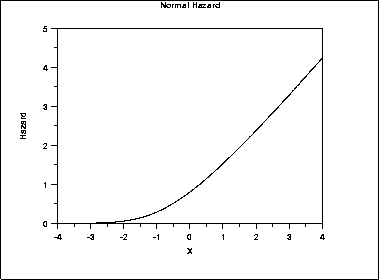
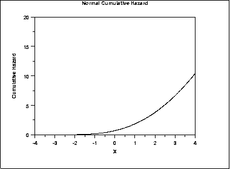
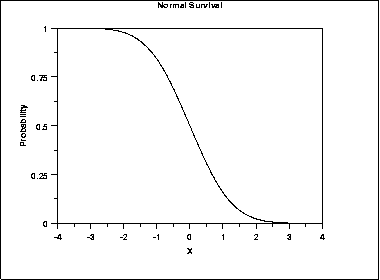
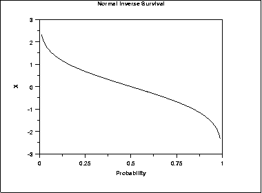

# Normal Distribution

Source: [NIST/SEMATECH e-Handbook of Statistical Methods — 1.3.6.6.1. Normal Distribution](https://www.itl.nist.gov/div898/handbook/eda/section3/eda3661.htm).

Retrieved: 2026-10-25. [Attribution and conversion notes](README.md#source-and-conversion-notes).

## Probability Density Function

The general formula for the [probability
density function](https://www.itl.nist.gov/div898/handbook/eda/section3/eda362.htm#PDF) of the normal distribution is

$$
f(x) = \frac{e^{-(x - \mu)^{2}/(2\sigma^{2}) }} {\sigma\sqrt{2\pi}}
$$

where *μ* is the [location parameter](https://www.itl.nist.gov/div898/handbook/eda/section3/eda364.htm) and
*σ* is the [scale parameter](https://www.itl.nist.gov/div898/handbook/eda/section3/eda364.htm). The case
where *μ* = 0 and *σ* = 1 is called the **standard
normal distribution**. The equation for the standard normal
distribution is

$$
f(x) = \frac{e^{-x^{2}/2}} {\sqrt{2\pi}}
$$

Since the general form of probability functions can be
[expressed in terms of the standard
distribution](https://www.itl.nist.gov/div898/handbook/eda/section3/eda364.htm#FORMULAS), all subsequent formulas in this section are
given for the standard form of the function.

The following is the plot of the standard normal probability density
function.

## Cumulative Distribution Function

The formula for the cumulative distribution function of the standard
normal distribution is

$$
F(x) = \int_{-\infty}^{x} \frac{e^{-x^{2}/2}} {\sqrt{2\pi}}
$$

Note that this integral does not exist in a simple closed formula. It is
computed numerically.

The following is the plot of the normal cumulative distribution
function.

## Percent Point Function

The formula for the [percent point
function](https://www.itl.nist.gov/div898/handbook/eda/section3/eda362.htm#PPF) of the normal distribution does not exist in
a simple closed formula. It is computed numerically.

The following is the plot of the normal percent point function.

## Hazard Function

The formula for the [hazard
function](https://www.itl.nist.gov/div898/handbook/eda/section3/eda362.htm#HAZ) of the normal distribution is

$$
h(x) = \frac{\phi(x)} {\Phi(-x)}
$$

where $\Phi$ is the cumulative distribution function of the standard
[normal](normal-distribution.md) distribution and $\phi$ is the probability
density function of the standard [normal](normal-distribution.md)
distribution.

The following is the plot of the normal hazard function.

## Cumulative Hazard Function

The normal [cumulative hazard function](https://www.itl.nist.gov/div898/handbook/eda/section3/eda362.htm#CUMHAZ)
can be computed from the normal cumulative distribution function.

The following is the plot of the normal cumulative hazard function.

## Survival Function

The normal [survival function](https://www.itl.nist.gov/div898/handbook/eda/section3/eda362.htm#SURVIVAL)
can be computed from the normal cumulative distribution function.

The following is the plot of the normal survival function.

## Inverse Survival Function

The normal [inverse survival
function](https://www.itl.nist.gov/div898/handbook/eda/section3/eda362.htm#INVERSESURVIVAL) can be computed from the normal percent point function.

The following is the plot of the normal inverse survival function.

## Common Statistics

|  |  |
| --- | --- |
| Mean | The location parameter *μ*. |
| Median | The location parameter *μ*. |
| Mode | The location parameter *μ*. |
| Range | $-\infty$ to $\infty$. |
| Standard Deviation | The scale parameter *σ*. |
| Coefficient of Variation | *σ*/*μ* |
| Skewness | 0 |
| Kurtosis | 3 |

## Parameter Estimation

The location and scale parameters of the normal distribution can
be estimated with the sample [mean](https://www.itl.nist.gov/div898/handbook/eda/section3/eda351.htm) and sample
[standard deviation](https://www.itl.nist.gov/div898/handbook/eda/section3/eda356.htm), respectively.

## Comments

For both theoretical and practical reasons, the normal distribution is
probably the most important distribution in statistics. For example,

- Many classical statistical tests are based on the assumption
  that the data follow a normal distribution. This assumption
  should be tested before applying these tests.
- In modeling applications, such as linear and non-linear
  regression, the error term is often assumed to follow a normal
  distribution with fixed location and scale.
- The normal distribution is used to find significance levels
  in many hypothesis tests and confidence intervals.

## Theroretical Justification - Central Limit Theorem

The normal distribution is widely used. Part of the appeal is
that it is well behaved and mathematically tractable. However,
the central limit theorem provides a theoretical basis for why it
has wide applicability.

The central limit theorem basically states that as the sample
size (*N*) becomes large, the following occur:

1. The sampling distribution of the mean becomes approximately
   normal regardless of the distribution of the original
   variable.
2. The sampling distribution of the mean is centered at the
   population mean, μ, of the
   original variable. In addition, the standard deviation
   of the sampling distribution of the mean approaches
   $\sigma / \sqrt{N}$.

## Software

Most general purpose statistical software programs support at least
some of the probability functions for the normal distribution.
