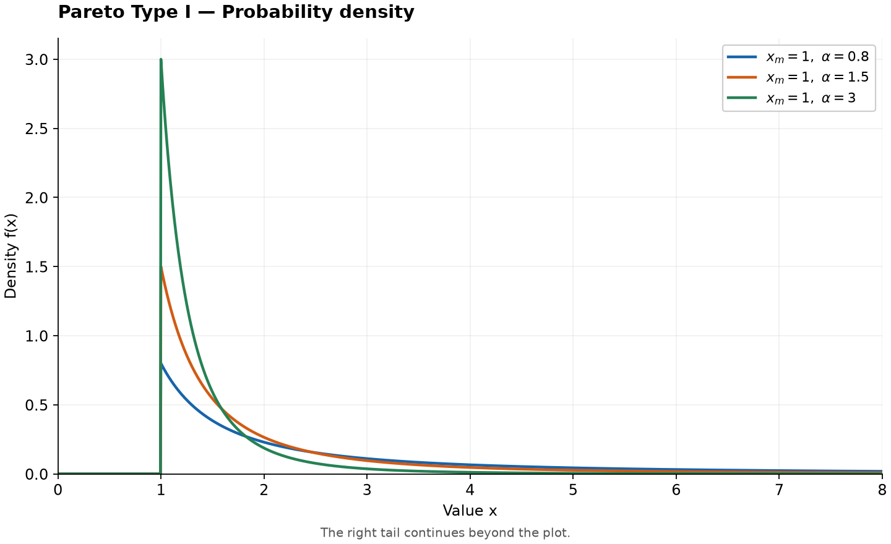
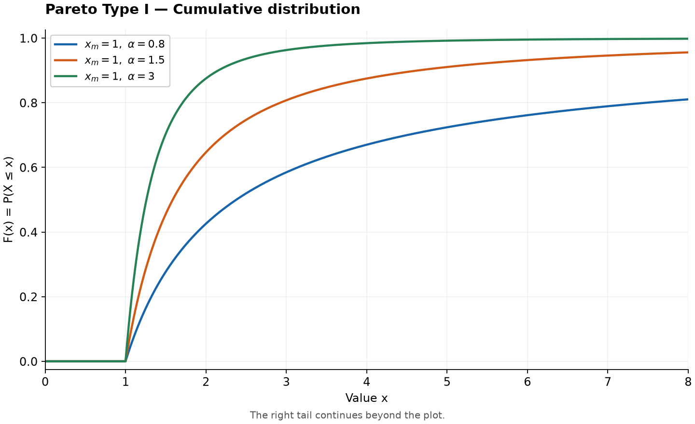

# Pareto Distribution

Original guide. Reference: [SciPy `pareto`](https://docs.scipy.org/doc/scipy/reference/generated/scipy.stats.pareto.html), checked 2026-10-25. [Collection notes](README.md#source-and-conversion-notes).

## Use and parameters

A simple model for positive values with a power-law upper tail. This guide uses Pareto Type I: minimum $x_m>0$, shape $\alpha>0$, and support $x\ge x_m$. Smaller $\alpha$ means a heavier tail.

## Probability Density Function

$$
f(x)=\frac{\alpha x_m^\alpha}{x^{\alpha+1}},\qquad x\ge x_m.
$$

The density is zero below $x_m$.

## Cumulative Distribution and Quantile Functions

For $x\ge x_m$ and $0<q<1$,

$$
F(x)=1-\left(\frac{x_m}{x}\right)^\alpha,\qquad Q(q)=x_m(1-q)^{-1/\alpha}.
$$

Below $x_m$, $F(x)=0$.

## Common Statistics

| Statistic | Value |
| --- | --- |
| Mean, $\alpha>1$ | $\alpha x_m/(\alpha-1)$ |
| Variance, $\alpha>2$ | $\alpha x_m^2/[(\alpha-1)^2(\alpha-2)]$ |
| Median | $x_m2^{1/\alpha}$ |

The mean diverges for $\alpha\le1$. A finite variance requires $\alpha>2$.

## Estimation and software

For fixed $x_m$ and observations $x_i\ge x_m$, $\hat\alpha=n/\sum_i\log(x_i/x_m)$ when the denominator is positive. Use `scipy.stats.pareto(alpha, loc=0, scale=x_m)`.

For $x_m=1$, $\alpha=2$, $P(X>10)=0.01$.

## Related distributions

Compare with [lognormal](lognormal-distribution.md) tails and [generalized extreme value](generalized-extreme-value-distribution.md) maxima.
