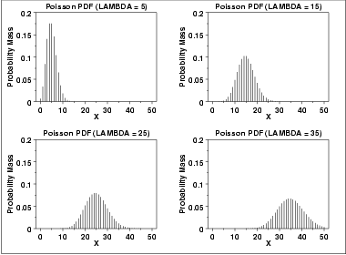
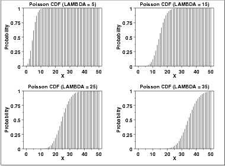
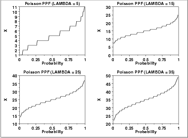

# Poisson Distribution

Source: [NIST/SEMATECH e-Handbook of Statistical Methods — 1.3.6.6.19. Poisson Distribution](https://www.itl.nist.gov/div898/handbook/eda/section3/eda366j.htm).

Retrieved: 2026-10-25. [Attribution and conversion notes](README.md#source-and-conversion-notes).

## Probability Mass Function

The Poisson distribution is used to model the number of events
occurring within a given time interval.

The formula for the Poisson probability mass function is

$$
p(x;\lambda) = \frac{e^{-\lambda}\lambda^{x}} {x!} \mbox{ for } x = 0, 1, 2, \cdots
$$

*λ* is the shape parameter which indicates the average number
of events in the given time interval.

The following is the plot of the Poisson probability density function
for four values of *λ*.

## Cumulative Distribution Function

The formula for the Poisson cumulative probability function is

$$
F(x;\lambda) = \sum_{i=0}^{x}{\frac{e^{-\lambda}\lambda^{i}} {i!}}
$$

The following is the plot of the Poisson cumulative distribution
function with the same values of *λ* as the pdf plots above.

## Percent Point Function

The Poisson percent point function does not exist in simple
closed form. It is computed numerically. Note that because
this is a discrete distribution that is only defined for integer
values of *x*, the percent point function is not smooth in the
way the percent point function typically is for a continuous
distribution.

The following is the plot of the Poisson percent point function
with the same values of *λ* as the pdf plots above.

## Common Statistics

|  |  |
| --- | --- |
| Mean | *λ* |
| Mode | For non-integer *λ*, it is the largest integer less than *λ*. For integer *λ*, *x* = *λ* and *x* = *λ* - 1 are both the mode. |
| Range | 0 to $\infty$ |
| Standard Deviation | $\sqrt{\lambda}$ |
| Coefficient of Variation | $\frac{1} {\sqrt{\lambda}}$ |
| Skewness | $\frac{1} {\sqrt{\lambda}}$ |
| Kurtosis | $3 + \frac{1} {\lambda}$ |

## Parameter Estimation

The maximum likelihood estimator of λ is

$$
\tilde{\lambda} = \bar{X}
$$

where
$\bar{X}$ is the sample mean.

## Software

Most general purpose statistical software programs support at least
some of the probability functions for the Poisson distribution.
