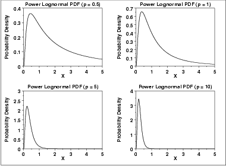
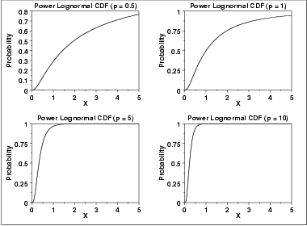
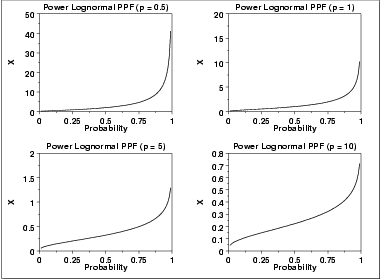
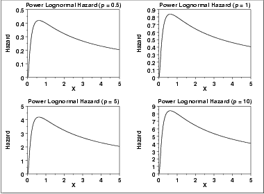
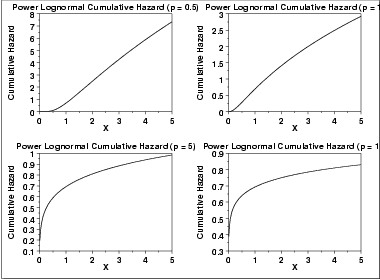
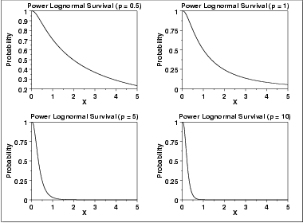
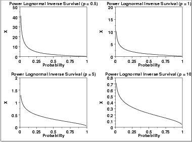

# Power Lognormal Distribution

Source: [NIST/SEMATECH e-Handbook of Statistical Methods — 1.3.6.6.14. Power Lognormal Distribution](https://www.itl.nist.gov/div898/handbook/eda/section3/eda366e.htm).

Retrieved: 2026-10-25. [Attribution and conversion notes](README.md#source-and-conversion-notes).

## Probability Density Function

The formula for the [probability density
function](https://www.itl.nist.gov/div898/handbook/eda/section3/eda362.htm#PDF) of the standard form of the power lognormal distribution
is

$$
f(x;p,\sigma) = (\frac{p} {x\sigma})\phi(\frac{\log x} {\sigma}) (\Phi(\frac{-\log x} {\sigma}))^{p-1} \hspace{.2in} x, p, \sigma > 0
$$

where ***p*** (also referred to as the power parameter) and
*σ* are the [shape parameters](https://www.itl.nist.gov/div898/handbook/eda/section3/eda363.htm),
$\Phi$ is the cumulative distribution function of the
[standard normal](normal-distribution.md) distribution, and
$\phi$ is the probability density function of the
[standard normal](normal-distribution.md) distribution.

As with other probability distributions, the power lognormal
distribution can be transformed with a [location
parameter](https://www.itl.nist.gov/div898/handbook/eda/section3/eda364.htm), *μ*, and a [scale parameter](https://www.itl.nist.gov/div898/handbook/eda/section3/eda364.htm),
***B***. We omit the equation for the general form of the power
lognormal distribution. Since the general form of probability functions
can be [expressed in terms of the standard
distribution](https://www.itl.nist.gov/div898/handbook/eda/section3/eda364.htm#FORMULAS), all subsequent formulas in this section are
given for the standard form of the function.

The following is the plot of the power lognormal probability density
function with four values of ***p*** and *σ* set to 1.

## Cumulative Distribution Function

The formula for the [cumulative distribution
function](https://www.itl.nist.gov/div898/handbook/eda/section3/eda362.htm#CDF) of the power lognormal distribution is

$$
F(x;p,\sigma) = 1 - (\Phi(\frac{-\log x} {\sigma}))^{p} \hspace{.2in} x, p, \sigma > 0
$$

where $\Phi$ is the cumulative distribution function of the standard
[normal](normal-distribution.md) distribution.

The following is the plot of the power lognormal cumulative
distribution function with the same values of ***p*** as
the pdf plots above.

## Percent Point Function

The formula for the [percent point
function](https://www.itl.nist.gov/div898/handbook/eda/section3/eda362.htm#PPF) of the power lognormal distribution is

$$
G(f;p,\sigma) = \exp{(\Phi^{-1}(1 - (1 - f)^{1/p})\sigma)} \hspace{.2in} 0 < p < 1; p, \sigma > 0
$$

where $\phi^{-1}$ is the percent point function of the standard
[normal](normal-distribution.md) distribution.

The following is the plot of the power lognormal percent point function
with the same values of ***p*** as the pdf plots above.

## Hazard Function

The formula for the [hazard
function](https://www.itl.nist.gov/div898/handbook/eda/section3/eda362.htm#HAZ) of the power lognormal distribution is

$$
h(x,p,\sigma) = \frac{p(\frac{1} {x\sigma})\phi(\frac{\log x} {\sigma})} {\Phi(\frac{-\log x} {\sigma})} \hspace{.2in} x, p, \sigma > 0
$$

where $\Phi$ is the cumulative distribution function of the standard
normal distribution, and $\phi$ is the probability density function of
the standard normal distribution.

Note that this is simply a multiple (*p*) of the
[lognormal hazard function](lognormal-distribution.md#HAZARD).

The following is the plot of the power lognormal hazard function
with the same values of ***p*** as the pdf plots above.

## Cumulative Hazard Function

The formula for the [cumulative hazard
function](https://www.itl.nist.gov/div898/handbook/eda/section3/eda362.htm#CUMHAZ) of the power lognormal distribution is

$$
H(x;p,\sigma) = -\log{((\Phi(\frac{-\log x} {\sigma}))^{p})} \hspace{.2in} x, p, \sigma > 0
$$

The following is the plot of the power lognormal cumulative hazard
function with the same values of ***p*** as the pdf plots
above.

## Survival Function

The formula for the [survival
function](https://www.itl.nist.gov/div898/handbook/eda/section3/eda362.htm#SURVIVAL) of the power lognormal distribution is

$$
S(x;p,\sigma) = (\Phi(\frac{-\log x} {\sigma}))^{p} \hspace{.2in} x, p, \sigma > 0
$$

The following is the plot of the power lognormal survival function
with the same values of ***p*** as the pdf plots above.

## Inverse Survival Function

The formula for the [inverse
survival function](https://www.itl.nist.gov/div898/handbook/eda/section3/eda362.htm#INVERSESURVIVAL) of the power lognormal distribution is

$$
Z(f;p,\sigma) = \exp{(\Phi^{-1}(1 - f^{1/p})\sigma)} \hspace{.2in} 0 < p < 1; p, \sigma > 0
$$

The following is the plot of the power lognormal inverse survival
function with the same values of ***p*** as the pdf plots
above.

## Common Statistics

The statistics for the power lognormal distribution are complicated
and require tables.
[Nelson](https://www.itl.nist.gov/div898/handbook/eda/section4/eda43.htm#Nelson2) discusses the
mean, median, mode, and standard deviation of the power lognormal
distribution and provides references to the appropriate tables.

## Parameter Estimation

[Nelson](https://www.itl.nist.gov/div898/handbook/eda/section4/eda43.htm#Nelson2) discusses maximum
likelihood estimation for the power lognormal distribution. These
estimates need to be performed with computer software. Software
for maximum likelihood estimation of the parameters of the
power lognormal distribution is not as readily available as for
other reliability distributions such as the exponential, Weibull,
and lognormal.

## Software

Most general purpose statistical software programs do not support
the probability functions for the power lognormal distribution.
