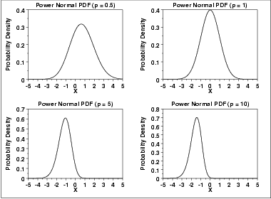
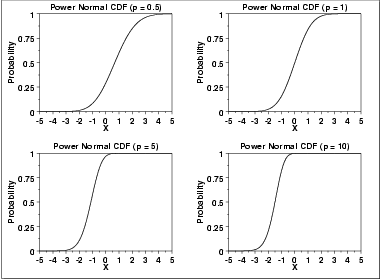
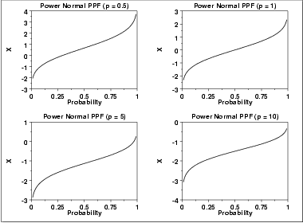
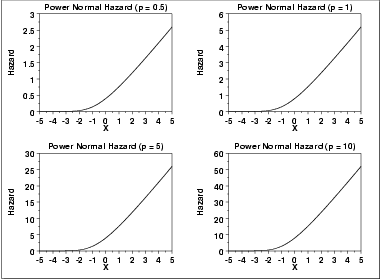
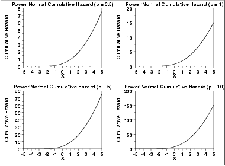
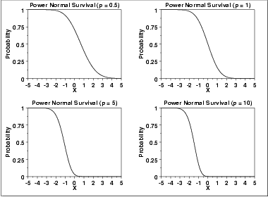
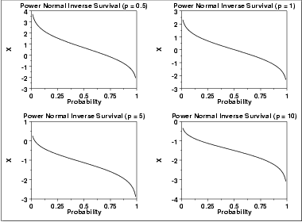

# Power Normal Distribution

Source: [NIST/SEMATECH e-Handbook of Statistical Methods — 1.3.6.6.13. Power Normal Distribution](https://www.itl.nist.gov/div898/handbook/eda/section3/eda366d.htm).

Retrieved: 2026-10-25. [Attribution and conversion notes](README.md#source-and-conversion-notes).

## Probability Density Function

The formula for the [probability density
function](https://www.itl.nist.gov/div898/handbook/eda/section3/eda362.htm#PDF) of the standard form of the power normal distribution is

$$
f(x;p) = p \phi(x) (\Phi(-x))^{p-1} \hspace{.3in} x, p > 0
$$

where ***p*** is the [shape parameter](https://www.itl.nist.gov/div898/handbook/eda/section3/eda363.htm)
(also referred to as the power parameter),
$\Phi$ is the cumulative distribution function of the
[standard normal](normal-distribution.md) distribution, and
$\phi$ is the probability density function of the
[standard normal](normal-distribution.md) distribution.

As with other probability distributions, the power normal distribution
can be transformed with a [location parameter](https://www.itl.nist.gov/div898/handbook/eda/section3/eda364.htm),
*μ*, and a [scale parameter](https://www.itl.nist.gov/div898/handbook/eda/section3/eda364.htm),
*σ*. We omit the equation for the general form of the power
normal distribution. Since the general form of probability functions can
be [expressed in terms of the standard
distribution](https://www.itl.nist.gov/div898/handbook/eda/section3/eda364.htm#FORMULAS), all subsequent formulas in this section are given for
the standard form of the function.

The following is the plot of the power normal probability density
function with four values of ***p***.

## Cumulative Distribution Function

The formula for the [cumulative distribution
function](https://www.itl.nist.gov/div898/handbook/eda/section3/eda362.htm#CDF) of the power normal distribution is

$$
F(x;p) = 1 - (\Phi(-x))^{p} \hspace{.3in} x, p > 0
$$

where $\Phi$ is the cumulative distribution function of the standard
[normal](normal-distribution.md) distribution.

The following is the plot of the power normal cumulative distribution
function with the same values of ***p*** as the pdf plots
above.

## Percent Point Function

The formula for the [percent point
function](https://www.itl.nist.gov/div898/handbook/eda/section3/eda362.htm#PPF) of the power normal distribution is

$$
G(f) = \Phi^{-1}(1 - (1 - f)^{1/p}) \hspace{.3in} 0 < f < 1; p > 0
$$

where $\phi^{-1}$ is the percent point function of the standard
[normal](normal-distribution.md) distribution.

The following is the plot of the power normal percent point function
with the same values of ***p*** as the pdf plots above.

## Hazard Function

The formula for the [hazard
function](https://www.itl.nist.gov/div898/handbook/eda/section3/eda362.htm#HAZ) of the power normal distribution is

$$
h(x;p) = \frac{p\phi(x)} {\Phi(-x)} \hspace{.3in} x, p > 0
$$

The following is the plot of the power normal hazard function
with the same values of ***p*** as the pdf plots above.

## Cumulative Hazard Function

The formula for the [cumulative hazard
function](https://www.itl.nist.gov/div898/handbook/eda/section3/eda362.htm#CUMHAZ) of the power normal distribution is

$$
H(x,p) = -\log{((\Phi(-x))^{p})} \hspace{.3in} x, p > 0
$$

The following is the plot of the power normal cumulative hazard
function with the same values of ***p*** as the pdf plots
above.

## Survival Function

The formula for the [survival
function](https://www.itl.nist.gov/div898/handbook/eda/section3/eda362.htm#SURVIVAL) of the power normal distribution is

$$
S(x;p) = (\Phi(-x))^{p} \hspace{.3in} x, p > 0
$$

The following is the plot of the power normal survival function
with the same values of ***p*** as the pdf plots above.

## Inverse Survival Function

The formula for the [inverse
survival function](https://www.itl.nist.gov/div898/handbook/eda/section3/eda362.htm#INVERSESURVIVAL) of the power normal distribution is

$$
Z(f) = \Phi^{-1}(1 - f^{1/p}) \hspace{.3in} 0 < f < 1; p > 0
$$

The following is the plot of the power normal inverse survival
function with the same values of ***p*** as the pdf plots
above.

## Common Statistics

The statistics for the power normal distribution are complicated
and require tables.
[Nelson](https://www.itl.nist.gov/div898/handbook/eda/section4/eda43.htm#Nelson2) discusses the
mean, median, mode, and standard deviation of the power normal
distribution and provides references to the appropriate tables.

## Software

Most general purpose statistical software programs do not support
the probability functions for the power normal distribution.
