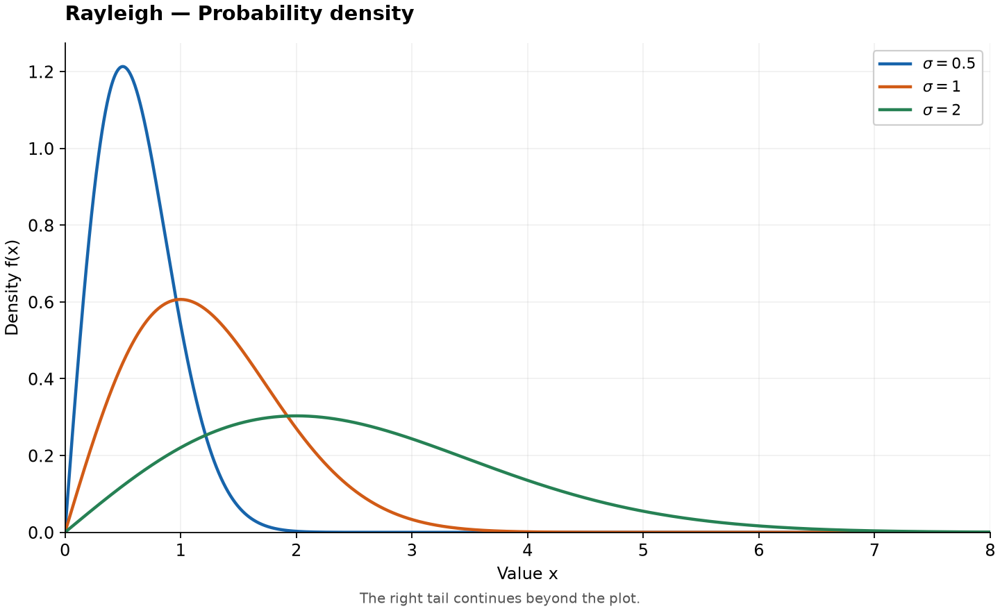
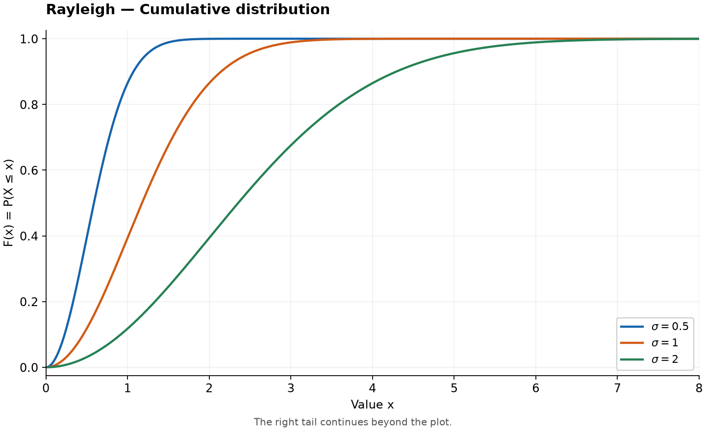

# Rayleigh Distribution

Original guide. Reference: [SciPy `rayleigh`](https://docs.scipy.org/doc/scipy/reference/generated/scipy.stats.rayleigh.html), checked 2026-10-25. [Collection notes](README.md#source-and-conversion-notes).

## Use and parameters

If $U,V$ are independent normal variables with mean zero and variance $\sigma^2$, their magnitude $X=\sqrt{U^2+V^2}$ is Rayleigh. This connects two-dimensional Gaussian noise to a positive amplitude. Scale $\sigma>0$; support $x\ge0$.

## Probability Density Function

$$
f(x)=\frac{x}{\sigma^2}\exp\left(-\frac{x^2}{2\sigma^2}\right),\qquad x\ge0.
$$

The density is zero below zero.

## Cumulative Distribution and Quantile Functions

For $x\ge0$ and $0<q<1$,

$$
F(x)=1-e^{-x^2/(2\sigma^2)},\qquad Q(q)=\sigma\sqrt{-2\log(1-q)}.
$$

Below zero, $F(x)=0$.

## Common Statistics

| Statistic | Value |
| --- | --- |
| Mean | $\sigma\sqrt{\pi/2}$ |
| Variance | $(2-\pi/2)\sigma^2$ |
| Median | $\sigma\sqrt{2\log2}$ |
| Mode | $\sigma$ |

## Estimation and software

With location fixed at zero, the maximum likelihood estimate is $\hat\sigma=\sqrt{\sum_i x_i^2/(2n)}$. Use `scipy.stats.rayleigh(scale=sigma)` or `.fit(data, floc=0)`.

## Related distributions

$X^2/\sigma^2$ is [chi-square](chi-square-distribution.md) with two degrees of freedom. Rayleigh is [Weibull](weibull-distribution.md) with shape 2 and scale $\sigma\sqrt2$.
