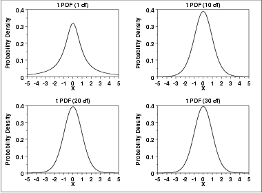
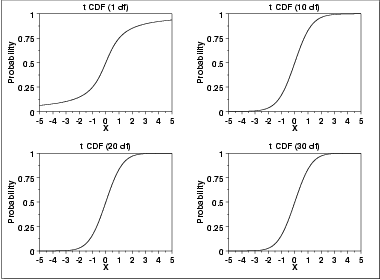
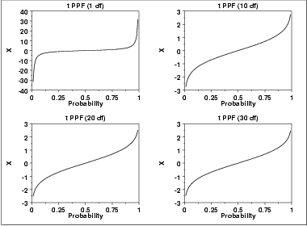

# t Distribution

Source: [NIST/SEMATECH e-Handbook of Statistical Methods — 1.3.6.6.4. t Distribution](https://www.itl.nist.gov/div898/handbook/eda/section3/eda3664.htm).

Retrieved: 2026-10-25. [Attribution and conversion notes](README.md#source-and-conversion-notes).

## Probability Density Function

The formula for the [probability density
function](https://www.itl.nist.gov/div898/handbook/eda/section3/eda362.htm#PDF) of the *t* distribution is

$$
f(x) = \frac{(1 + \frac{x^2}{\nu})^{\frac{-(\nu + 1)} {2}}} {B(0.5,0.5\nu)\sqrt{\nu}}
$$

where ***B*** is the beta function and *ν* is a positive
integer shape parameter. The formula for the beta function is

$$
B(\alpha,\beta) = \int_{0}^{1} {t^{\alpha-1}(1-t)^{\beta-1}dt}
$$

In a testing context, the *t* distribution is treated as a
"standardized distribution" (i.e., no location or scale parameters).
However, in a distributional modeling context (as with other
probability distributions), the *t* distribution itself can be
transformed with a [location parameter](https://www.itl.nist.gov/div898/handbook/eda/section3/eda364.htm),
*μ*, and a [scale parameter](https://www.itl.nist.gov/div898/handbook/eda/section3/eda364.htm),
*σ*.

The following is the plot of the *t* probability density function
for 4 different values of the shape parameter.

These plots all have a similar shape. The difference is in the heaviness
of the tails. In fact, the *t* distribution with ν equal to 1 is
a [Cauchy](cauchy-distribution.md) distribution. The *t*
distribution approaches a [normal](normal-distribution.md) distribution
as *ν* becomes large. The approximation is quite good for values
of *ν* > 30.

## Cumulative Distribution Function

The formula for the [cumulative distribution
function](https://www.itl.nist.gov/div898/handbook/eda/section3/eda362.htm#CDF) of the *t* distribution is complicated and is not
included here. It is given in the
[Evans, Hastings, and Peacock](https://www.itl.nist.gov/div898/handbook/eda/section4/eda43.htm#EVANS)
book.

The following are the plots of the *t* cumulative distribution
function with the same values of *ν* as the pdf plots above.

## Percent Point Function

The formula for the [percent point
function](https://www.itl.nist.gov/div898/handbook/eda/section3/eda362.htm#PPF) of the *t* distribution does not exist in
a simple closed form. It is computed numerically.

The following are the plots of the *t* percent point function
with the same values of *ν* as the pdf plots above.

## Other Probability Functions

Since the *t* distribution is typically used to develop
hypothesis tests and confidence intervals and rarely for modeling
applications, we omit the formulas and plots for the hazard,
cumulative hazard, survival, and inverse survival probability
functions.

## Common Statistics

|  |  |
| --- | --- |
| Mean | 0 (It is undefined for ν equal to 1.) |
| Median | 0 |
| Mode | 0 |
| Range | $-\infty \mbox{ to } \infty$ |
| Standard Deviation | $\sqrt{\frac {\nu} {(\nu - 2)}}$ It is undefined for *ν* equal to 1 or 2. |
| Coefficient of Variation | Undefined |
| Skewness | 0. It is undefined for *ν* less than or equal to 3. However, the *t* distribution is symmetric in all cases. |
| Kurtosis | $\frac {3(\nu-2)} {(\nu - 4)}$ It is undefined for *ν* less than or equal to 4. |

## Parameter Estimation

Since the *t* distribution is typically used to develop
hypothesis tests and confidence intervals and rarely for modeling
applications, we omit any discussion of parameter estimation.

## Comments

The *t* distribution is used in many cases for the critical
regions for hypothesis tests and in determining confidence intervals.
The most common example is
[testing if data are
consistent with the assumed process mean](https://www.itl.nist.gov/div898/handbook/prc/section2/prc22.htm).

## Software

Most general purpose statistical software programs support at least
some of the probability functions for the *t* distribution.
