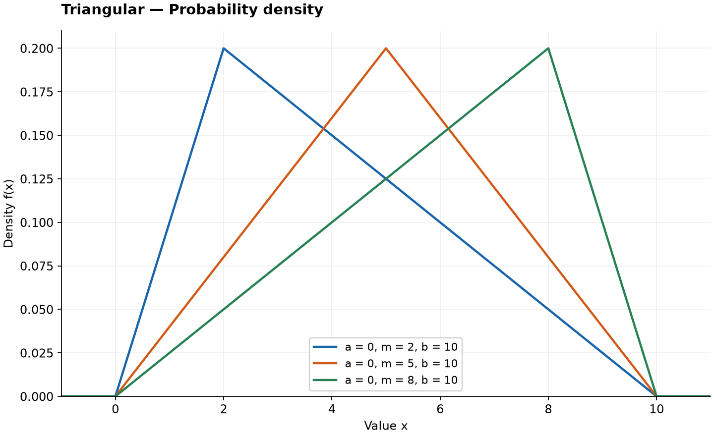
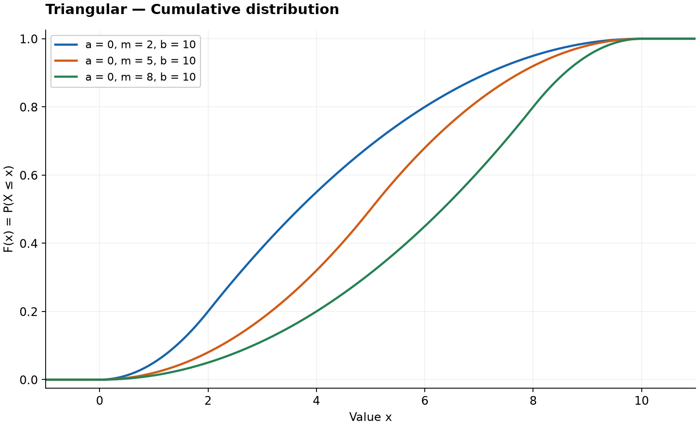

# Triangular Distribution

Original guide. Reference: [SciPy `triang`](https://docs.scipy.org/doc/scipy/reference/generated/scipy.stats.triang.html), checked 2026-10-25. [Collection notes](README.md#source-and-conversion-notes).

## Use and parameters

A bounded model specified by minimum $a$, maximum $b$, and most likely value $m$. Assume $a<m<b$. It offers an intuitive simulation model when these three values are available.

## Probability Density Function

$$
f(x)=\begin{cases}
2(x-a)/[(b-a)(m-a)],&a\le x\le m,\\
2(b-x)/[(b-a)(b-m)],&m<x\le b,\\
0,&\text{otherwise}.
\end{cases}
$$

## Cumulative Distribution Function

$$
F(x)=\begin{cases}
0,&x<a,\\
(x-a)^2/[(b-a)(m-a)],&a\le x\le m,\\
1-(b-x)^2/[(b-a)(b-m)],&m<x\le b,\\
1,&x>b.
\end{cases}
$$

## Percent Point Function

Set $c=(m-a)/(b-a)$. For $0<q<1$,

$$
Q(q)=\begin{cases}
a+\sqrt{q(b-a)(m-a)},&q\le c,\\
b-\sqrt{(1-q)(b-a)(b-m)},&q>c.
\end{cases}
$$

## Common Statistics

| Statistic | Value |
| --- | --- |
| Mean | $(a+b+m)/3$ |
| Variance | $(a^2+b^2+m^2-ab-am-bm)/18$ |
| Mode | $m$ |

## Estimation and software

Parameters are often elicited as assumptions. Use `scipy.stats.triang(c, loc=a, scale=b-a)`. SciPy also allows endpoint modes $m=a$ or $m=b$; use the corresponding limiting single-slope density rather than dividing by zero above.

## Related distributions

Compare with [uniform](uniform-distribution.md) for equal density across an interval, or [beta](beta-distribution.md) for more flexible bounded shapes.
