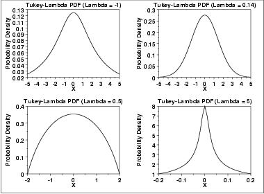
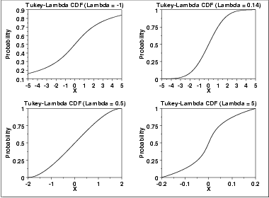
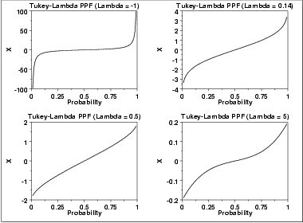

# Tukey-Lambda Distribution

Source: [NIST/SEMATECH e-Handbook of Statistical Methods — 1.3.6.6.15. Tukey-Lambda Distribution](https://www.itl.nist.gov/div898/handbook/eda/section3/eda366f.htm).

Retrieved: 2026-10-25. [Attribution and conversion notes](README.md#source-and-conversion-notes).

## Probability Density Function

The Tukey-Lambda density function does not have a simple, closed form.
It is computed numerically.

The Tukey-Lambda distribution has the [shape
parameter](https://www.itl.nist.gov/div898/handbook/eda/section3/eda363.htm) *λ*. As with other probability distributions,
the Tukey-Lambda distribution can be transformed with a
[location parameter](https://www.itl.nist.gov/div898/handbook/eda/section3/eda364.htm), *μ*, and a
[scale parameter](https://www.itl.nist.gov/div898/handbook/eda/section3/eda364.htm), *σ*. Since the
general form of probability functions can be
[expressed in terms of the standard
distribution](https://www.itl.nist.gov/div898/handbook/eda/section3/eda364.htm#FORMULAS), all subsequent formulas in this section are given for
the standard form of the function.

The following is the plot of the Tukey-Lambda probability density
function for four values of *λ*.

## Cumulative Distribution Function

The Tukey-Lambda distribution does not have a simple, closed form.
It is computed numerically.

The following is the plot of the Tukey-Lambda cumulative distribution
function with the same values of *λ* as the pdf plots above.

## Percent Point Function

The formula for the [percent point
function](https://www.itl.nist.gov/div898/handbook/eda/section3/eda362.htm#PPF) of the standard form of the Tukey-Lambda distribution is

$$
G(p;\lambda) = \frac{p^{\lambda} - (1 - p)^{\lambda}} {\lambda}
$$

The following is the plot of the Tukey-Lambda percent point function
with the same values of *λ* as the pdf plots above.

## Other Probability Functions

The Tukey-Lambda distribution is typically used to identify
an appropriate distribution (see the comments below) and not
used in statistical models directly. For this reason, we omit the
formulas, and plots for the hazard, cumulative hazard, survival, and
inverse survival functions. We also omit the common statistics and
parameter estimation sections.

## Comments

The Tukey-Lambda distribution is actually a family of distributions
that can approximate a number of common distributions. For example,

|  |  |
| --- | --- |
| *λ* = -1 | approximately Cauchy |
| *λ* = 0 | exactly logistic |
| *λ* = 0.14 | approximately normal |
| *λ* = 0.5 | U-shaped |
| *λ* = 1 | exactly uniform (from -1 to +1) |

The most common use of this distribution is to generate a Tukey-Lambda
[PPCC plot](https://www.itl.nist.gov/div898/handbook/eda/section3/ppccplot.htm) of a data set. Based on the ppcc
plot, an appropriate model for the data is suggested. For example, if
the maximum correlation occurs for a value of *λ* at or near
0.14, then the data can be modeled with a normal distribution. Values of
*λ* less than this imply a heavy-tailed distribution (with -1
approximating a Cauchy). That is, as the optimal value of *λ*
goes from 0.14 to -1, increasingly heavy tails are implied. Similarly, as
the optimal value of *λ* becomes greater than 0.14, shorter
tails are implied.

As the Tukey-Lambda distribution is a symmetric distribution, the
use of the Tukey-Lambda PPCC plot to determine a reasonable
distribution to model the data only applies to symmetric distributions.
A [histogram](https://www.itl.nist.gov/div898/handbook/eda/section3/histogra.htm) of the data should provide
evidence as to whether the data can be reasonably modeled with a
symmetric distribution.

## Software

Most general purpose statistical software programs do not support
the probability functions for the Tukey-Lambda distribution.
