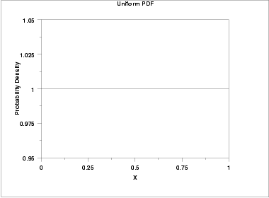
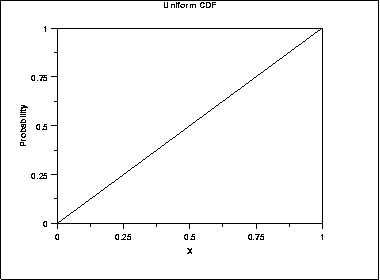
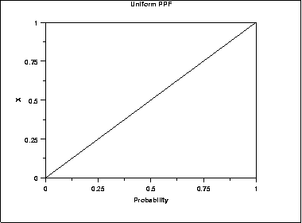
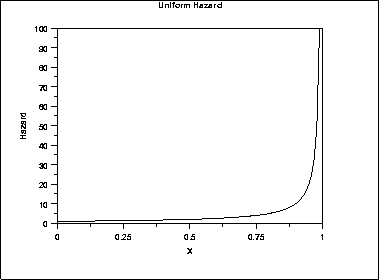
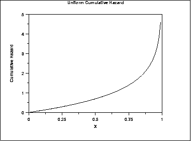
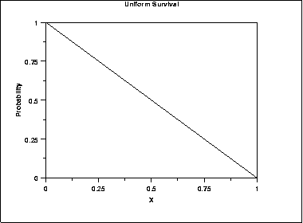
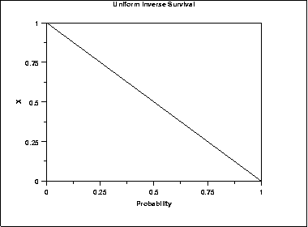

# Uniform Distribution

Source: [NIST/SEMATECH e-Handbook of Statistical Methods — 1.3.6.6.2. Uniform Distribution](https://www.itl.nist.gov/div898/handbook/eda/section3/eda3662.htm).

Retrieved: 2026-10-25. [Attribution and conversion notes](README.md#source-and-conversion-notes).

## Probability Density Function

The general formula for the [probability
density function](https://www.itl.nist.gov/div898/handbook/eda/section3/eda362.htm#PDF) of the uniform distribution is

$$
f(x) = \frac{1} {B - A} \;\;\;\;\;\;\; \mbox{for} \ A \le x \le B
$$

where A is the [location parameter](https://www.itl.nist.gov/div898/handbook/eda/section3/eda364.htm) and (B - A)
is the [scale parameter](https://www.itl.nist.gov/div898/handbook/eda/section3/eda364.htm). The case where A = 0
and B = 1 is called the **standard uniform distribution**. The
equation for the standard uniform distribution is

$$
f(x) = 1 \;\;\;\;\;\;\; \mbox{for} \ 0 \le x \le 1
$$

Since the general form of probability functions can be
[expressed in terms of the standard
distribution](https://www.itl.nist.gov/div898/handbook/eda/section3/eda364.htm#FORMULAS), all subsequent formulas in this section are
given for the standard form of the function.

The following is the plot of the uniform probability density function.

## Cumulative Distribution Function

The formula for the [cumulative distribution
function](https://www.itl.nist.gov/div898/handbook/eda/section3/eda362.htm#CDF) of the uniform distribution is

$$
F(x) = x \;\;\;\;\;\;\; \mbox{for} \ 0 \le x \le 1
$$

The following is the plot of the uniform cumulative distribution
function.

## Percent Point Function

The formula for the [percent point
function](https://www.itl.nist.gov/div898/handbook/eda/section3/eda362.htm#PPF) of the uniform distribution is

$$
G(p) = p \;\;\;\;\;\;\; \mbox{for} \ 0 \le p \le 1
$$

The following is the plot of the uniform percent point function.

## Hazard Function

The formula for the [hazard
function](https://www.itl.nist.gov/div898/handbook/eda/section3/eda362.htm#HAZARD) of the uniform distribution is

$$
h(x) = \frac{1} {1-x} \;\;\;\;\;\;\; \mbox{for} \ 0 \le x < 1
$$

The following is the plot of the uniform hazard function.

## Cumulative Hazard Function

The formula for the [cumulative
hazard function](https://www.itl.nist.gov/div898/handbook/eda/section3/eda362.htm#CUMHAZ) of the uniform distribution is

$$
H(x) = -ln{(1-x)} \;\;\;\;\;\;\; \mbox{for} \ 0 \le x < 1
$$

The following is the plot of the uniform cumulative hazard function.

## Survival Function

The formula for the uniform [survival
function](https://www.itl.nist.gov/div898/handbook/eda/section3/eda362.htm#SURVIVAL) is

$$
S(x) = 1 - x \;\;\;\;\;\;\; \mbox{for} \ 0 \le x \le 1
$$

The following is the plot of the uniform survival function.

## Inverse Survival Function

The formula for the uniform [inverse
survival function](https://www.itl.nist.gov/div898/handbook/eda/section3/eda362.htm#INVERSESURVIVAL) is

$$
Z(p) = 1 - p \;\;\;\;\;\;\; \mbox{for} \ 0 \le p \le 1
$$

The following is the plot of the uniform inverse survival function.

## Common Statistics

|  |  |
| --- | --- |
| Mean | (A + B)/2 |
| Median | (A + B)/2 |
| Range | B - A |
| Standard Deviation | $\sqrt{\frac{(B - A)^{2}} {12}}$ |
| Coefficient of Variation | $\frac{(B - A)} {\sqrt{3}(B + A)}$ |
| Skewness | 0 |
| Kurtosis | 9/5 |

## Parameter Estimation

The method of moments estimators for A and B are

$$
\hat{A} = \bar{x} - \sqrt{3}s
$$
  
$$
\hat{B} = \bar{x} + \sqrt{3}s
$$

The maximum likelihood estimators are usually given in terms
of the parameters *a* and *h* where

*A* = *a* - *h*
  
*B* = *a* + *h*
The maximum likelihood estimators for *a* and *h* are

$$
\hat{a} = \mbox{midrange}(Y_{1}, Y_{2}, ... , Y_{n})
$$
  
$$
\hat{h} = 0.5[\mbox{range}(Y_{1}, Y_{2}, ... , Y_{n})]
$$
This gives the following maximum likelihood estimators for A and B

$$
\hat{A} = \mbox{midrange}(Y_{1}, Y_{2}, ... , Y_{n}) - 0.5[\mbox{range}(Y_{1}, Y_{2}, ... , Y_{n})] = Y_{1}
$$
  
$$
\hat{B} = \mbox{midrange}(Y_{1}, Y_{2}, ... , Y_{n}) + 0.5[\mbox{range}(Y_{1}, Y_{2}, ... , Y_{n})] = Y_{n}
$$

## Comments

The uniform distribution defines equal probability over a given range
for a continuous distribution. For this reason, it is important as a
reference distribution.

One of the most important applications of the uniform distribution
is in the generation of random numbers. That is, almost all
random number generators generate random numbers on the (0,1)
interval. For other distributions, some transformation is applied
to the uniform random numbers.

## Software

Most general purpose statistical software programs support at least
some of the probability functions for the uniform distribution.
