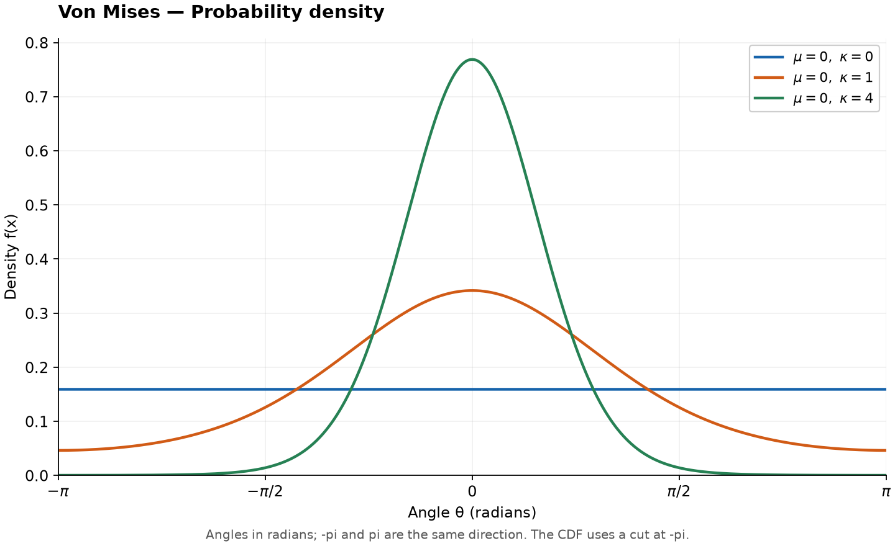
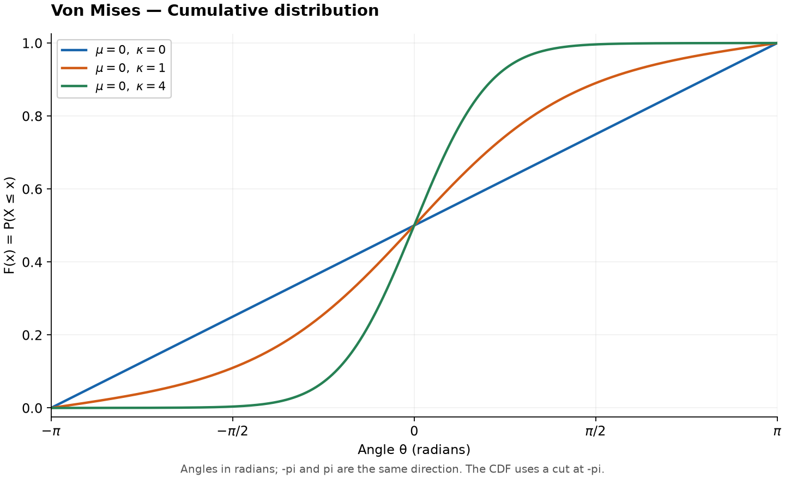

# Von Mises Distribution

Original guide. Reference: [SciPy `vonmises`](https://docs.scipy.org/doc/scipy/reference/generated/scipy.stats.vonmises.html), checked 2026-10-25. [Collection notes](README.md#source-and-conversion-notes).

## Use and parameters

Models angles, such as directions, with wraparound: $-\pi$ and $\pi$ represent the same direction. Parameters are mean direction $\mu$ modulo $2\pi$ and concentration $\kappa\ge0$. Angles are in radians.

## Probability Density Function

Over one complete revolution,

$$
f(\theta)=\frac{e^{\kappa\cos(\theta-\mu)}}{2\pi I_0(\kappa)},
$$

where $I_0$ is the modified Bessel function. At $\kappa=0$ the density is uniform; larger concentration tightens the peak.

## Cumulative Distribution and Quantile Functions

Choose a cut at $\mu-\pi$. For $\mu-\pi\le\theta\le\mu+\pi$,

$$
F(\theta)=\int_{\mu-\pi}^{\theta}f(u)\,du.
$$

CDF and quantiles require numerical evaluation. A circular CDF depends on the cut; SciPy extends it so $F(\theta+2\pi)=F(\theta)+1$.

## Common Statistics

| Statistic | Value |
| --- | --- |
| Mean direction, $\kappa>0$ | $\mu$ |
| Mean resultant length | $I_1(\kappa)/I_0(\kappa)$ |
| Circular variance | $1-I_1(\kappa)/I_0(\kappa)$ |

The uniform case has no unique mean direction.

## Estimation and software

Estimate direction with `atan2(mean(sin(theta)), mean(cos(theta)))`; estimate concentration numerically. Use `scipy.stats.vonmises(kappa, loc=mu)`. Its `scale` argument has no effect. Use circular statistics rather than ordinary arithmetic means.
