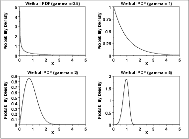
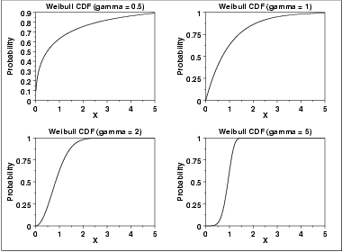
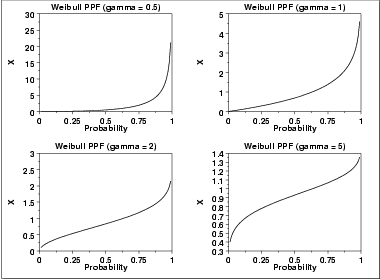
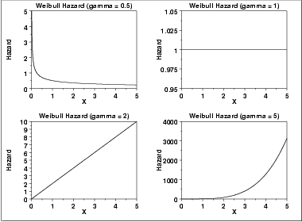
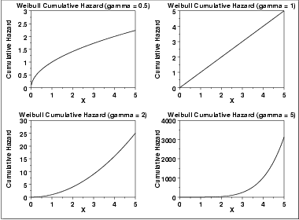
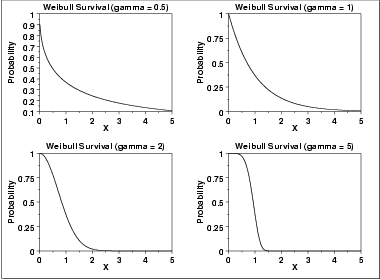
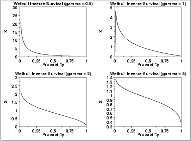

# Weibull Distribution

Source: [NIST/SEMATECH e-Handbook of Statistical Methods — 1.3.6.6.8. Weibull Distribution](https://www.itl.nist.gov/div898/handbook/eda/section3/eda3668.htm).

Retrieved: 2026-10-25. [Attribution and conversion notes](README.md#source-and-conversion-notes).

## Probability Density Function

The formula for the [probability density
function](https://www.itl.nist.gov/div898/handbook/eda/section3/eda362.htm#PDF) of the general Weibull distribution is

$$
f(x) = \frac{\gamma} {\alpha} (\frac{x-\mu} {\alpha})^{(\gamma - 1)}\exp{(-((x-\mu)/\alpha)^{\gamma})} \hspace{.3in} x \ge \mu; \gamma, \alpha > 0
$$

where *γ* is the [shape parameter](https://www.itl.nist.gov/div898/handbook/eda/section3/eda363.htm),
*μ* is the [location parameter](https://www.itl.nist.gov/div898/handbook/eda/section3/eda364.htm) and
*α* is the [scale parameter](https://www.itl.nist.gov/div898/handbook/eda/section3/eda364.htm). The case
where *μ* = 0 and *α* = 1 is called the **standard
Weibull distribution**. The case where *μ* = 0 is called the
2-parameter Weibull distribution. The equation for the standard Weibull
distribution reduces to

$$
f(x) = \gamma x^{(\gamma - 1)}\exp(-(x^{\gamma})) \hspace{.3in} x \ge 0; \gamma > 0
$$

Since the general form of probability functions can be
[expressed in terms of the standard
distribution](https://www.itl.nist.gov/div898/handbook/eda/section3/eda364.htm#FORMULAS), all subsequent formulas in this section are
given for the standard form of the function.

The following is the plot of the Weibull probability density function.

## Cumulative Distribution Function

The formula for the [cumulative distribution
function](https://www.itl.nist.gov/div898/handbook/eda/section3/eda362.htm#CDF) of the Weibull distribution is

$$
F(x) = 1 - e^{-(x^{\gamma})} \hspace{.3in} x \ge 0; \gamma > 0
$$

The following is the plot of the Weibull cumulative distribution
function with the same values of *γ* as the pdf plots above.

## Percent Point Function

The formula for the [percent point
function](https://www.itl.nist.gov/div898/handbook/eda/section3/eda362.htm#PPF) of the Weibull distribution is

$$
G(p) = (-\ln(1 - p))^{1/\gamma} \hspace{.3in} 0 \le p < 1; \gamma > 0
$$

The following is the plot of the Weibull percent point function with
the same values of *γ* as the pdf plots above.

## Hazard Function

The formula for the [hazard
function](https://www.itl.nist.gov/div898/handbook/eda/section3/eda362.htm#HAZ) of the Weibull distribution is

$$
h(x) = \gamma x^{(\gamma - 1)} \hspace{.3in} x \ge 0; \gamma > 0
$$

The following is the plot of the Weibull hazard function with the
same values of *γ* as the pdf plots above.

## Cumulative Hazard Function

The formula for the [cumulative hazard
function](https://www.itl.nist.gov/div898/handbook/eda/section3/eda362.htm#HAZ) of the Weibull distribution is

$$
H(x) = x^{\gamma} \hspace{.3in} x \ge 0; \gamma > 0
$$

The following is the plot of the Weibull cumulative hazard function
with the same values of *γ* as the pdf plots above.

## Survival Function

The formula for the [survival
function](https://www.itl.nist.gov/div898/handbook/eda/section3/eda362.htm#SURVIVAL) of the Weibull distribution is

$$
S(x) = \exp{-(x^{\gamma})} \hspace{.3in} x \ge 0; \gamma > 0
$$

The following is the plot of the Weibull survival function
with the same values of *γ* as the pdf plots above.

## Inverse Survival Function

The formula for the [inverse
survival function](https://www.itl.nist.gov/div898/handbook/eda/section3/eda362.htm#INVERSESURVIVAL) of the Weibull distribution is

$$
Z(p) = (-\ln(p))^{1/\gamma} \hspace{.3in} 0 \le p < 1; \gamma > 0
$$

The following is the plot of the Weibull inverse survival function
with the same values of *γ* as the pdf plots above.

## Common Statistics

The formulas below are with the location parameter equal to zero
and the scale parameter equal to one.

|  |  |
| --- | --- |
| Mean | $\Gamma(\frac{\gamma + 1} {\gamma})$ where Γ is the gamma function  $\Gamma(a) = \int_{0}^{\infty} {t^{a-1}e^{-t}dt}$ |
| Median | $\ln(2)^{1/\gamma}$ |
| Mode | $(1 - \frac{1} {\gamma})^{1/\gamma} \hspace{.2in} \gamma > 1$   $0 \hspace{1.05in} \gamma \le 1$ |
| Range | 0 to $\infty$. |
| Standard Deviation | $\sqrt{\Gamma(\frac{\gamma + 2} {\gamma}) - (\Gamma(\frac{\gamma + 1} {\gamma}))^{2}}$ |
| Coefficient of Variation | $\sqrt{\frac{\Gamma(\frac{\gamma + 2} {\gamma})} {(\Gamma(\frac{\gamma + 1} {\gamma}))^{2}} - 1}$ |

## Parameter Estimation

[Maximum likelihood
estimation for the Weibull distribution](https://www.itl.nist.gov/div898/handbook/apr/section4/apr413.htm) is discussed
in the [Reliability](https://www.itl.nist.gov/div898/handbook/apr/apr.htm) chapter
(Chapter 8). It is also discussed in Chapter 21 of
[Johnson, Kotz, and
Balakrishnan](https://www.itl.nist.gov/div898/handbook/eda/section4/eda43.htm#Johnson).

## Comments

The Weibull distribution is used extensively in
[reliability](https://www.itl.nist.gov/div898/handbook/apr/apr.htm) applications to
model failure times.

## Software

Most general purpose statistical software programs support at least
some of the probability functions for the Weibull distribution.
